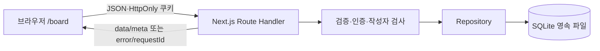

# studyMidpoint — 중간 응용 — 로그인 게시판

[전체 과정](README.md) · [노션 원문](https://app.notion.com/p/3d6d7dec5e2e81afb534c64042625cc6)

## ① 목표 한 줄

study0~10의 기능만으로 회원·게시글·댓글이 있는 작은 서비스를 완성한다.

## ② 📖 이론

작은 서비스는 화면을 나열하는 것보다 사용자 흐름을 완성하는 것이 중요하다. 가입 → 로그인 → 글·댓글 CRUD → 다른 계정 권한 확인 → 로그아웃까지 한 흐름으로 묶는다.

여기서는 demo의 기초 API와 /board, /lab만 사용한다. UI·상태·폼 라이브러리, 외부 결제·메일·OAuth, AI, 실시간 기능을 사용하지 않는다. 누적 저장소에는 후반 예제 모듈도 있지만 demo의 HTTP 진입점은 core handle에 연결되어 있다.

중간 프로젝트는 조립한 자전거를 실제로 타 보는 단계다. 부품별로 배운 환경·화면·저장·인증이 한 사용자 경험 안에서 이어져야 한다.

## ③ 🛠️ 실기 — 전체 코드와 줄별 설명

기준: Next.js 16.4.6 App Router, Node 24.14.0. 예시는 TSX이며 JSX 버전은 같은 경로에서 타입과 확장자만 다르다. 앱은 누적 완성본이므로 현재 단계의 파일과 아래 구현 순서를 중심으로 읽는다. 기존 코드를 복제해 중첩 프로젝트를 생성하지 않는다.

### 기능 목록

공개 글 목록·검색·상세, 가입·로그인, 본인 글 작성·수정·삭제, 댓글, 오류 메시지와 중복 제출 방지다.

### 폴더 구조

```text
demo/
  app/board/page.tsx
  app/api/[...path]/route.ts
  app/health/route.ts
  course/{domain,repository,security,http,api,client}.ts
  course/{board,draft}.tsx
  data/course.db
  .env.local
```


### 단계별 구현 순서

1. 폴더를 app의 화면·route와 course의 domain/repository/security/http/api/client/board로 나눈다.
2. Repository → 모델/검증 → 인증 → v1 CRUD → 화면 순서로 구현한다. 먼저 /health와 가입 API를 확인한 뒤 UI를 붙인다.
3. 단계별 실행: 가입하고 로그인한 뒤 글을 등록한다. 두 번째 계정으로 수정 403을 확인하고 원 계정으로 삭제한다.
4. 테스트·빌드·실서버 smoke를 통과시킨 뒤 1차 배포 체크리스트를 작성하고 회고한다.

~~~powershell
cd tsx_version/demo
npm ci
Copy-Item .env.example .env.local
# JWT_SECRET 난수 설정 후
npm run dev
# 별도 검증 터미널
npm test
npm run build
npm run test:http
~~~

### DB·API 연동 구성도



### 1차 배포 체크리스트

- [ ] 기초 API 목록을 모두 호출했다.
- [ ] 두 계정의 수정·삭제 권한이 분리된다.
- [ ] 빈 값·깨진 JSON·없는 id·중복 가입을 처리한다.
- [ ] 테스트·린트·빌드·HTTP smoke가 통과한다.
- [ ] HTTPS·환경변수·영속 DB·health를 확인했다.

### 회고

기능 단위 테스트만으로는 Next의 실제 경로 우선순위를 놓칠 수 있어 HTTP smoke가 필요했다. 화면의 숨김 버튼은 보안 경계가 아니므로 API에서 작성자 검사를 반복했다. 다음 확장 전에는 데이터 증가량과 백업·복원 시간을 측정해 한 행 저장소의 한계를 판단한다.

### tsx_version/demo/app/board/page.tsx

[실행 파일](tsx_version/demo/app/board/page.tsx)

아래는 실제 저장된 파일 전체다. 공용 모듈의 import는 링크한 파일과 package-lock.json의 설치 결과를 사용한다.

<!-- source:tsx_version/demo/app/board/page.tsx sha256:b2809273f3435ac5fb1288cf242108493744c4e5f5fa51f7859dba1f6461f95b -->
~~~tsx
import { Board } from '@/course/board';
export default function Page() { return <Board />; }
~~~

줄 번호는 위 코드 블록의 첫 줄부터 센다. 빈 줄은 설명 표에서 제외한다.

| 줄 | 설명 |
|---|---|
| 1 | 외부 모듈 또는 공용 함수·타입을 가져온다: { Board } from '@/course/board'; |
| 2 | 현재 구문에서 다음 값·인자·표현식을 연결한다: export default function Page() { return <Board />; } |

### tsx_version/demo/app/api/[...path]/route.ts

[실행 파일](tsx_version/demo/app/api/[...path]/route.ts)

아래는 실제 저장된 파일 전체다. 공용 모듈의 import는 링크한 파일과 package-lock.json의 설치 결과를 사용한다.

<!-- source:tsx_version/demo/app/api/[...path]/route.ts sha256:a6fe6c02c42bea6a545f265e8f74caf423bc8325f7eaa7dfb27b059e0ed49944 -->
~~~ts
import { handle } from '@/course/api';
export const runtime = 'nodejs';
export const dynamic = 'force-dynamic';
// Next의 두 번째 인자(context)를 내부 extension 콜백으로 넘기지 않는다.
function dispatch(request: Request) { return handle(request); }
export { dispatch as GET, dispatch as POST, dispatch as PATCH, dispatch as DELETE, dispatch as OPTIONS, dispatch as PUT };
~~~

줄 번호는 위 코드 블록의 첫 줄부터 센다. 빈 줄은 설명 표에서 제외한다.

| 줄 | 설명 |
|---|---|
| 1 | 외부 모듈 또는 공용 함수·타입을 가져온다: { handle } from '@/course/api'; |
| 2 | 이름 있는 값·설정·함수 또는 상태를 준비한다: export const runtime = 'nodejs'; |
| 3 | 이름 있는 값·설정·함수 또는 상태를 준비한다: export const dynamic = 'force-dynamic'; |
| 4 | 주석: Next의 두 번째 인자(context)를 내부 extension 콜백으로 넘기지 않는다. |
| 5 | dispatch의 입력·반환 경계를 정의한다. |
| 6 | 현재 구문에서 다음 값·인자·표현식을 연결한다: export { dispatch as GET, dispatch as POST, dispatch as PATCH, dispatch as DELETE, dispatch as OPTIONS, dispatch as PUT }; |

### tsx_version/demo/course/domain.ts

[실행 파일](tsx_version/demo/course/domain.ts)

아래는 실제 저장된 파일 전체다. 공용 모듈의 import는 링크한 파일과 package-lock.json의 설치 결과를 사용한다.

<!-- source:tsx_version/demo/course/domain.ts sha256:2fc8388465af58fb08e336cbed41d6c05a2cda1c324d3397a4a16d5b74bf4a14 -->
~~~ts
export type User = {
  id: number;
  email: string;
  nickname: string;
  passwordHash: string;
  githubId?: number;
};
export type Post = {
  id: number;
  title: string;
  body: string;
  tags: string[];
  authorId: number;
  createdAt: string;
  updatedAt: string;
};
export type Comment = {
  id: number;
  postId: number;
  authorId: number;
  body: string;
  createdAt: string;
};
export type Job = {
  id: number;
  ownerId: number;
  status: "pending" | "done" | "failed";
  attempts: number;
  text: string;
  result?: string;
};
export type State = {
  seq: number;
  users: User[];
  posts: Post[];
  comments: Comment[];
  files: { id: number; ownerId: number; name: string; text: string }[];
  jobs: Job[];
  revoked: string[];
  webhookIds: string[];
};
export const emptyState = (): State => ({
  seq: 0,
  users: [],
  posts: [],
  comments: [],
  files: [],
  jobs: [],
  revoked: [],
  webhookIds: [],
});
export class ApiError extends Error {
  constructor(
    public status: number,
    public code: string,
    message: string,
    public fields: Record<string, string[]> = {},
  ) {
    super(message);
  }
}
export function text(value: unknown, field: string, max: number) {
  if (typeof value !== "string" || !value.trim() || value.trim().length > max)
    throw new ApiError(400, "VALIDATION_ERROR", "입력값을 확인하세요.", {
      [field]: [`1~${max}자로 입력하세요.`],
    });
  return value.trim();
}
export function identifier(value: string) {
  if (!/^[1-9]\d*$/.test(value) || !Number.isSafeInteger(Number(value)))
    throw new ApiError(400, "BAD_REQUEST", "id는 양의 정수입니다.");
  return Number(value);
}
export function publicUser(user: User) {
  return { id: user.id, email: user.email, nickname: user.nickname };
}
export function postView(state: State, post: Post) {
  const user = state.users.find((u) => u.id === post.authorId)!;
  return {
    id: post.id,
    title: post.title,
    body: post.body,
    tags: post.tags,
    author: { id: user.id, nickname: user.nickname },
    commentCount: state.comments.filter((c) => c.postId === post.id).length,
    createdAt: post.createdAt,
    updatedAt: post.updatedAt,
  };
}
export function listPosts(state: State, query: URLSearchParams) {
  const number = (key: string, fallback: number) => {
    const raw = query.get(key);
    if (raw === null) return fallback;
    if (!/^[1-9]\d*$/.test(raw) || !Number.isSafeInteger(Number(raw)))
      throw new ApiError(400, "BAD_REQUEST", `${key}는 양의 정수입니다.`);
    return Number(raw);
  };
  const page = number("page", 1),
    limit = Math.min(number("limit", 10), 50),
    q = query.get("q") ?? "";
  const sort = query.get("sort") ?? "-createdAt";
  if (!["createdAt", "-createdAt", "-commentCount"].includes(sort))
    throw new ApiError(400, "BAD_REQUEST", "정렬 값을 확인하세요.");
  const rows = state.posts
    .filter((p) =>
      `${p.title}\n${p.body}`.toLowerCase().includes(q.toLowerCase()),
    )
    .map((p) => postView(state, p));
  rows.sort((a, b) =>
    sort === "-commentCount"
      ? b.commentCount - a.commentCount || b.id - a.id
      : (sort === "createdAt" ? 1 : -1) *
        (a.createdAt.localeCompare(b.createdAt) || a.id - b.id),
  );
  return {
    data: rows.slice((page - 1) * limit, page * limit),
    meta: {
      page,
      limit,
      total: rows.length,
      totalPages: Math.ceil(rows.length / limit),
      q,
    },
  };
}
~~~

줄 번호는 위 코드 블록의 첫 줄부터 센다. 빈 줄은 설명 표에서 제외한다.

| 줄 | 설명 |
|---|---|
| 1 | 다른 모듈이 공유할 데이터 구조를 선언한다: export type User = { |
| 2 | 객체·스키마·속성의 값을 지정한다: id: number; |
| 3 | 객체·스키마·속성의 값을 지정한다: email: string; |
| 4 | 객체·스키마·속성의 값을 지정한다: nickname: string; |
| 5 | 객체·스키마·속성의 값을 지정한다: passwordHash: string; |
| 6 | 현재 구문에서 다음 값·인자·표현식을 연결한다: githubId?: number; |
| 7 | 열었던 블록·객체·배열·호출 또는 JSX 표현식을 닫는다. |
| 8 | 다른 모듈이 공유할 데이터 구조를 선언한다: export type Post = { |
| 9 | 객체·스키마·속성의 값을 지정한다: id: number; |
| 10 | 객체·스키마·속성의 값을 지정한다: title: string; |
| 11 | 객체·스키마·속성의 값을 지정한다: body: string; |
| 12 | 객체·스키마·속성의 값을 지정한다: tags: string[]; |
| 13 | 객체·스키마·속성의 값을 지정한다: authorId: number; |
| 14 | 객체·스키마·속성의 값을 지정한다: createdAt: string; |
| 15 | 객체·스키마·속성의 값을 지정한다: updatedAt: string; |
| 16 | 열었던 블록·객체·배열·호출 또는 JSX 표현식을 닫는다. |
| 17 | 다른 모듈이 공유할 데이터 구조를 선언한다: export type Comment = { |
| 18 | 객체·스키마·속성의 값을 지정한다: id: number; |
| 19 | 객체·스키마·속성의 값을 지정한다: postId: number; |
| 20 | 객체·스키마·속성의 값을 지정한다: authorId: number; |
| 21 | 객체·스키마·속성의 값을 지정한다: body: string; |
| 22 | 객체·스키마·속성의 값을 지정한다: createdAt: string; |
| 23 | 열었던 블록·객체·배열·호출 또는 JSX 표현식을 닫는다. |
| 24 | 다른 모듈이 공유할 데이터 구조를 선언한다: export type Job = { |
| 25 | 객체·스키마·속성의 값을 지정한다: id: number; |
| 26 | 객체·스키마·속성의 값을 지정한다: ownerId: number; |
| 27 | 객체·스키마·속성의 값을 지정한다: status: "pending" \| "done" \| "failed"; |
| 28 | 객체·스키마·속성의 값을 지정한다: attempts: number; |
| 29 | 객체·스키마·속성의 값을 지정한다: text: string; |
| 30 | 현재 구문에서 다음 값·인자·표현식을 연결한다: result?: string; |
| 31 | 열었던 블록·객체·배열·호출 또는 JSX 표현식을 닫는다. |
| 32 | 다른 모듈이 공유할 데이터 구조를 선언한다: export type State = { |
| 33 | 객체·스키마·속성의 값을 지정한다: seq: number; |
| 34 | 객체·스키마·속성의 값을 지정한다: users: User[]; |
| 35 | 객체·스키마·속성의 값을 지정한다: posts: Post[]; |
| 36 | 객체·스키마·속성의 값을 지정한다: comments: Comment[]; |
| 37 | 객체·스키마·속성의 값을 지정한다: files: { id: number; ownerId: number; name: string; text: string }[]; |
| 38 | 객체·스키마·속성의 값을 지정한다: jobs: Job[]; |
| 39 | 객체·스키마·속성의 값을 지정한다: revoked: string[]; |
| 40 | 객체·스키마·속성의 값을 지정한다: webhookIds: string[]; |
| 41 | 열었던 블록·객체·배열·호출 또는 JSX 표현식을 닫는다. |
| 42 | 이름 있는 값·설정·함수 또는 상태를 준비한다: export const emptyState = (): State => ({ |
| 43 | 객체·스키마·속성의 값을 지정한다: seq: 0, |
| 44 | 객체·스키마·속성의 값을 지정한다: users: [], |
| 45 | 객체·스키마·속성의 값을 지정한다: posts: [], |
| 46 | 객체·스키마·속성의 값을 지정한다: comments: [], |
| 47 | 객체·스키마·속성의 값을 지정한다: files: [], |
| 48 | 객체·스키마·속성의 값을 지정한다: jobs: [], |
| 49 | 객체·스키마·속성의 값을 지정한다: revoked: [], |
| 50 | 객체·스키마·속성의 값을 지정한다: webhookIds: [], |
| 51 | 열었던 블록·객체·배열·호출 또는 JSX 표현식을 닫는다. |
| 52 | 상태 코드·오류 code·필드 오류를 함께 전달할 오류 객체를 정의한다. |
| 53 | 현재 구문에서 다음 값·인자·표현식을 연결한다: constructor( |
| 54 | 현재 구문에서 다음 값·인자·표현식을 연결한다: public status: number, |
| 55 | 현재 구문에서 다음 값·인자·표현식을 연결한다: public code: string, |
| 56 | 객체·스키마·속성의 값을 지정한다: message: string, |
| 57 | 현재 구문에서 다음 값·인자·표현식을 연결한다: public fields: Record<string, string[]> = {}, |
| 58 | 현재 구문에서 다음 값·인자·표현식을 연결한다: ) { |
| 59 | 현재 구문에서 다음 값·인자·표현식을 연결한다: super(message); |
| 60 | 열었던 블록·객체·배열·호출 또는 JSX 표현식을 닫는다. |
| 61 | 열었던 블록·객체·배열·호출 또는 JSX 표현식을 닫는다. |
| 62 | text의 입력·반환 경계를 정의한다. |
| 63 | 입력·상태 조건에 따라 처리 경로를 고른다: if (typeof value !== "string" \|\| !value.trim() \|\| value.trim().length > max) |
| 64 | 요청 처리를 중단하고 공통 오류 응답에 상태·code·설명을 전달한다: throw new ApiError(400, "VALIDATION_ERROR", "입력값을 확인하세요.", { |
| 65 | 현재 구문에서 다음 값·인자·표현식을 연결한다: [field]: [ˋ1~${max}자로 입력하세요.ˋ], |
| 66 | 열었던 블록·객체·배열·호출 또는 JSX 표현식을 닫는다. |
| 67 | 현재 함수의 처리 결과를 호출자 또는 화면에 반환한다: return value.trim(); |
| 68 | 열었던 블록·객체·배열·호출 또는 JSX 표현식을 닫는다. |
| 69 | identifier의 입력·반환 경계를 정의한다. |
| 70 | 독립적으로 확인할 동작과 기대 결과를 테스트로 묶는다: if (!/^[1-9]\d*$/.test(value) \|\| !Number.isSafeInteger(Number(value))) |
| 71 | 요청 처리를 중단하고 공통 오류 응답에 상태·code·설명을 전달한다: throw new ApiError(400, "BAD_REQUEST", "id는 양의 정수입니다."); |
| 72 | 현재 함수의 처리 결과를 호출자 또는 화면에 반환한다: return Number(value); |
| 73 | 열었던 블록·객체·배열·호출 또는 JSX 표현식을 닫는다. |
| 74 | publicUser의 입력·반환 경계를 정의한다. |
| 75 | 현재 함수의 처리 결과를 호출자 또는 화면에 반환한다: return { id: user.id, email: user.email, nickname: user.nickname }; |
| 76 | 열었던 블록·객체·배열·호출 또는 JSX 표현식을 닫는다. |
| 77 | postView의 입력·반환 경계를 정의한다. |
| 78 | 이름 있는 값·설정·함수 또는 상태를 준비한다: const user = state.users.find((u) => u.id === post.authorId)!; |
| 79 | 현재 함수의 처리 결과를 호출자 또는 화면에 반환한다: return { |
| 80 | 객체·스키마·속성의 값을 지정한다: id: post.id, |
| 81 | 객체·스키마·속성의 값을 지정한다: title: post.title, |
| 82 | 객체·스키마·속성의 값을 지정한다: body: post.body, |
| 83 | 객체·스키마·속성의 값을 지정한다: tags: post.tags, |
| 84 | 객체·스키마·속성의 값을 지정한다: author: { id: user.id, nickname: user.nickname }, |
| 85 | 객체·스키마·속성의 값을 지정한다: commentCount: state.comments.filter((c) => c.postId === post.id).length, |
| 86 | 객체·스키마·속성의 값을 지정한다: createdAt: post.createdAt, |
| 87 | 객체·스키마·속성의 값을 지정한다: updatedAt: post.updatedAt, |
| 88 | 열었던 블록·객체·배열·호출 또는 JSX 표현식을 닫는다. |
| 89 | 열었던 블록·객체·배열·호출 또는 JSX 표현식을 닫는다. |
| 90 | listPosts의 입력·반환 경계를 정의한다. |
| 91 | 이름 있는 값·설정·함수 또는 상태를 준비한다: const number = (key: string, fallback: number) => { |
| 92 | 이름 있는 값·설정·함수 또는 상태를 준비한다: const raw = query.get(key); |
| 93 | 입력·상태 조건에 따라 처리 경로를 고른다: if (raw === null) return fallback; |
| 94 | 독립적으로 확인할 동작과 기대 결과를 테스트로 묶는다: if (!/^[1-9]\d*$/.test(raw) \|\| !Number.isSafeInteger(Number(raw))) |
| 95 | 요청 처리를 중단하고 공통 오류 응답에 상태·code·설명을 전달한다: throw new ApiError(400, "BAD_REQUEST", ˋ${key}는 양의 정수입니다.ˋ); |
| 96 | 현재 함수의 처리 결과를 호출자 또는 화면에 반환한다: return Number(raw); |
| 97 | 열었던 블록·객체·배열·호출 또는 JSX 표현식을 닫는다. |
| 98 | 이름 있는 값·설정·함수 또는 상태를 준비한다: const page = number("page", 1), |
| 99 | 현재 구문에서 다음 값·인자·표현식을 연결한다: limit = Math.min(number("limit", 10), 50), |
| 100 | 현재 구문에서 다음 값·인자·표현식을 연결한다: q = query.get("q") ?? ""; |
| 101 | 이름 있는 값·설정·함수 또는 상태를 준비한다: const sort = query.get("sort") ?? "-createdAt"; |
| 102 | 입력·상태 조건에 따라 처리 경로를 고른다: if (!["createdAt", "-createdAt", "-commentCount"].includes(sort)) |
| 103 | 요청 처리를 중단하고 공통 오류 응답에 상태·code·설명을 전달한다: throw new ApiError(400, "BAD_REQUEST", "정렬 값을 확인하세요."); |
| 104 | 이름 있는 값·설정·함수 또는 상태를 준비한다: const rows = state.posts |
| 105 | 현재 구문에서 다음 값·인자·표현식을 연결한다: .filter((p) => |
| 106 | 현재 구문에서 다음 값·인자·표현식을 연결한다: ˋ${p.title}\n${p.body}ˋ.toLowerCase().includes(q.toLowerCase()), |
| 107 | 열었던 블록·객체·배열·호출 또는 JSX 표현식을 닫는다. |
| 108 | 현재 구문에서 다음 값·인자·표현식을 연결한다: .map((p) => postView(state, p)); |
| 109 | 현재 구문에서 다음 값·인자·표현식을 연결한다: rows.sort((a, b) => |
| 110 | 현재 구문에서 다음 값·인자·표현식을 연결한다: sort === "-commentCount" |
| 111 | 현재 구문에서 다음 값·인자·표현식을 연결한다: ? b.commentCount - a.commentCount \|\| b.id - a.id |
| 112 | 현재 구문에서 다음 값·인자·표현식을 연결한다: : (sort === "createdAt" ? 1 : -1) * |
| 113 | 현재 구문에서 다음 값·인자·표현식을 연결한다: (a.createdAt.localeCompare(b.createdAt) \|\| a.id - b.id), |
| 114 | 열었던 블록·객체·배열·호출 또는 JSX 표현식을 닫는다. |
| 115 | 현재 함수의 처리 결과를 호출자 또는 화면에 반환한다: return { |
| 116 | 객체·스키마·속성의 값을 지정한다: data: rows.slice((page - 1) * limit, page * limit), |
| 117 | 객체·스키마·속성의 값을 지정한다: meta: { |
| 118 | 현재 구문에서 다음 값·인자·표현식을 연결한다: page, |
| 119 | 현재 구문에서 다음 값·인자·표현식을 연결한다: limit, |
| 120 | 객체·스키마·속성의 값을 지정한다: total: rows.length, |
| 121 | 객체·스키마·속성의 값을 지정한다: totalPages: Math.ceil(rows.length / limit), |
| 122 | 현재 구문에서 다음 값·인자·표현식을 연결한다: q, |
| 123 | 열었던 블록·객체·배열·호출 또는 JSX 표현식을 닫는다. |
| 124 | 열었던 블록·객체·배열·호출 또는 JSX 표현식을 닫는다. |
| 125 | 열었던 블록·객체·배열·호출 또는 JSX 표현식을 닫는다. |

### tsx_version/demo/course/repository.ts

[실행 파일](tsx_version/demo/course/repository.ts)

read는 현재 상태를 읽고 change는 원자적인 읽기·수정·쓰기를 제공한다. 드라이버별 잠금 또는 revision 비교가 동시 갱신의 유실을 막는다.

<!-- source:tsx_version/demo/course/repository.ts sha256:20739512abb6a63a59f943f4560d172e3c9cc0b0659ecb23ef0e73d7885caba9 -->
~~~ts
import type { State } from './domain';
export type Repository = { read(): Promise<State>; change<T>(fn: (state: State) => T): Promise<T> };
export { getSqliteRepository as getRepository } from './sqlite-repository';
~~~

줄 번호는 위 코드 블록의 첫 줄부터 센다. 빈 줄은 설명 표에서 제외한다.

| 줄 | 설명 |
|---|---|
| 1 | 외부 모듈 또는 공용 함수·타입을 가져온다: type { State } from './domain'; |
| 2 | 다른 모듈이 공유할 데이터 구조를 선언한다: export type Repository = { read(): Promise<State>; change<T>(fn: (state: State) => T): Promise<T> }; |
| 3 | 현재 구문에서 다음 값·인자·표현식을 연결한다: export { getSqliteRepository as getRepository } from './sqlite-repository'; |

### tsx_version/demo/course/security.ts

[실행 파일](tsx_version/demo/course/security.ts)

비밀번호·토큰·쿠키·Origin·호출 제한을 한 서버 모듈에서 처리한다. UI 상태를 신뢰하지 않고 API 요청마다 세션과 작성자를 검사한다.

<!-- source:tsx_version/demo/course/security.ts sha256:c87d5c779709bd3a3cbfd6a2e2e1189f8992bc0be801d596670172f64d09e393 -->
~~~ts
import bcrypt from "bcryptjs";
import jwt from "jsonwebtoken";
import { ApiError, type State } from "./domain";
export const COOKIE = "course_session";
export function secret() {
  const value = process.env.JWT_SECRET;
  if (!value || value.length < 32)
    throw new ApiError(
      503,
      "CONFIG_REQUIRED",
      "JWT_SECRET을 32자 이상 설정하세요.",
    );
  return value;
}
export const hashPassword = (password: string) => bcrypt.hash(password, 12);
export const checkPassword = (password: string, hash: string) =>
  bcrypt.compare(password, hash);
export function issueToken(id: number) {
  return jwt.sign({ sub: String(id), jti: crypto.randomUUID() }, secret(), {
    algorithm: "HS256",
    expiresIn: "1h",
    issuer: "next-study",
    audience: "next-study",
  });
}
export function tokenFrom(request: Request) {
  const bearer = request.headers.get("authorization");
  if (bearer?.startsWith("Bearer ")) return bearer.slice(7);
  return request.headers
    .get("cookie")
    ?.split(";")
    .map((s) => s.trim())
    .find((s) => s.startsWith(`${COOKIE}=`))
    ?.slice(COOKIE.length + 1);
}
export function authenticate(request: Request, state: State) {
  const token = tokenFrom(request);
  if (!token) throw new ApiError(401, "UNAUTHORIZED", "로그인이 필요합니다.");
  try {
    const payload = jwt.verify(token, secret(), {
      algorithms: ["HS256"],
      issuer: "next-study",
      audience: "next-study",
    }) as jwt.JwtPayload;
    const user = state.users.find((u) => String(u.id) === payload.sub);
    if (!user || !payload.jti || state.revoked.includes(payload.jti))
      throw new Error("invalid session");
    return { user, jti: payload.jti };
  } catch (error) {
    if (error instanceof ApiError) throw error;
    throw new ApiError(
      401,
      "UNAUTHORIZED",
      "세션이 만료되었거나 유효하지 않습니다.",
    );
  }
}
export function sessionCookie(token: string, maxAge = 3600) {
  return `${COOKIE}=${token}; Path=/; HttpOnly; SameSite=Lax; Max-Age=${maxAge}${process.env.NODE_ENV === "production" ? "; Secure" : ""}`;
}
export function protectOrigin(request: Request) {
  if (["GET", "HEAD", "OPTIONS"].includes(request.method)) return;
  const expected = process.env.APP_ORIGIN ?? new URL(request.url).origin;
  const origin = request.headers.get("origin");
  if (origin && origin !== expected)
    throw new ApiError(403, "FORBIDDEN", "허용되지 않은 출처입니다.");
  if (!origin && tokenFrom(request) && !request.headers.get("authorization"))
    throw new ApiError(
      403,
      "FORBIDDEN",
      "쿠키 쓰기 요청에는 Origin이 필요합니다.",
    );
}
const attempts = new Map<string, { count: number; until: number }>();
export function rateLimit(key: string, max = 30) {
  const now = Date.now();
  for (const [k, v] of attempts) if (v.until <= now) attempts.delete(k);
  const entry = attempts.get(key) ?? { count: 0, until: now + 60_000 };
  if (++entry.count > max)
    throw new ApiError(429, "RATE_LIMITED", "잠시 후 다시 시도하세요.");
  attempts.set(key, entry); // 단일 프로세스 학습용. 복제 배포에서는 공유 저장소로 바꾼다.
}
~~~

줄 번호는 위 코드 블록의 첫 줄부터 센다. 빈 줄은 설명 표에서 제외한다.

| 줄 | 설명 |
|---|---|
| 1 | 외부 모듈 또는 공용 함수·타입을 가져온다: bcrypt from "bcryptjs"; |
| 2 | 외부 모듈 또는 공용 함수·타입을 가져온다: jwt from "jsonwebtoken"; |
| 3 | 외부 모듈 또는 공용 함수·타입을 가져온다: { ApiError, type State } from "./domain"; |
| 4 | 이름 있는 값·설정·함수 또는 상태를 준비한다: export const COOKIE = "course_session"; |
| 5 | secret의 입력·반환 경계를 정의한다. |
| 6 | 이름 있는 값·설정·함수 또는 상태를 준비한다: const value = process.env.JWT_SECRET; |
| 7 | 입력·상태 조건에 따라 처리 경로를 고른다: if (!value \|\| value.length < 32) |
| 8 | 요청 처리를 중단하고 공통 오류 응답에 상태·code·설명을 전달한다: throw new ApiError( |
| 9 | 현재 구문에서 다음 값·인자·표현식을 연결한다: 503, |
| 10 | 현재 구문에서 다음 값·인자·표현식을 연결한다: "CONFIG_REQUIRED", |
| 11 | 현재 구문에서 다음 값·인자·표현식을 연결한다: "JWT_SECRET을 32자 이상 설정하세요.", |
| 12 | 열었던 블록·객체·배열·호출 또는 JSX 표현식을 닫는다. |
| 13 | 현재 함수의 처리 결과를 호출자 또는 화면에 반환한다: return value; |
| 14 | 열었던 블록·객체·배열·호출 또는 JSX 표현식을 닫는다. |
| 15 | 비밀번호를 안전한 해시로 저장하거나 입력 비밀번호와 해시를 비교한다. |
| 16 | 이름 있는 값·설정·함수 또는 상태를 준비한다: export const checkPassword = (password: string, hash: string) => |
| 17 | 비밀번호를 안전한 해시로 저장하거나 입력 비밀번호와 해시를 비교한다. |
| 18 | issueToken의 입력·반환 경계를 정의한다. |
| 19 | JWT를 발급하거나 허용 알고리즘·발급자·대상·만료 조건으로 검증한다. |
| 20 | 객체·스키마·속성의 값을 지정한다: algorithm: "HS256", |
| 21 | 객체·스키마·속성의 값을 지정한다: expiresIn: "1h", |
| 22 | 객체·스키마·속성의 값을 지정한다: issuer: "next-study", |
| 23 | 객체·스키마·속성의 값을 지정한다: audience: "next-study", |
| 24 | 열었던 블록·객체·배열·호출 또는 JSX 표현식을 닫는다. |
| 25 | 열었던 블록·객체·배열·호출 또는 JSX 표현식을 닫는다. |
| 26 | tokenFrom의 입력·반환 경계를 정의한다. |
| 27 | 이름 있는 값·설정·함수 또는 상태를 준비한다: const bearer = request.headers.get("authorization"); |
| 28 | 입력·상태 조건에 따라 처리 경로를 고른다: if (bearer?.startsWith("Bearer ")) return bearer.slice(7); |
| 29 | 현재 함수의 처리 결과를 호출자 또는 화면에 반환한다: return request.headers |
| 30 | 현재 구문에서 다음 값·인자·표현식을 연결한다: .get("cookie") |
| 31 | 현재 구문에서 다음 값·인자·표현식을 연결한다: ?.split(";") |
| 32 | 현재 구문에서 다음 값·인자·표현식을 연결한다: .map((s) => s.trim()) |
| 33 | 현재 구문에서 다음 값·인자·표현식을 연결한다: .find((s) => s.startsWith(ˋ${COOKIE}=ˋ)) |
| 34 | 현재 구문에서 다음 값·인자·표현식을 연결한다: ?.slice(COOKIE.length + 1); |
| 35 | 열었던 블록·객체·배열·호출 또는 JSX 표현식을 닫는다. |
| 36 | authenticate의 입력·반환 경계를 정의한다. |
| 37 | 이름 있는 값·설정·함수 또는 상태를 준비한다: const token = tokenFrom(request); |
| 38 | 요청 처리를 중단하고 공통 오류 응답에 상태·code·설명을 전달한다: if (!token) throw new ApiError(401, "UNAUTHORIZED", "로그인이 필요합니다."); |
| 39 | 실패 가능한 처리를 시작하고 아래 catch/finally와 연결한다. |
| 40 | JWT를 발급하거나 허용 알고리즘·발급자·대상·만료 조건으로 검증한다. |
| 41 | 객체·스키마·속성의 값을 지정한다: algorithms: ["HS256"], |
| 42 | 객체·스키마·속성의 값을 지정한다: issuer: "next-study", |
| 43 | 객체·스키마·속성의 값을 지정한다: audience: "next-study", |
| 44 | 현재 구문에서 다음 값·인자·표현식을 연결한다: }) as jwt.JwtPayload; |
| 45 | 이름 있는 값·설정·함수 또는 상태를 준비한다: const user = state.users.find((u) => String(u.id) === payload.sub); |
| 46 | 입력·상태 조건에 따라 처리 경로를 고른다: if (!user \|\| !payload.jti \|\| state.revoked.includes(payload.jti)) |
| 47 | 현재 조건을 정상 처리할 수 없어 예외를 발생시킨다. 상위 오류 처리 또는 CLI가 실패를 기록한다: throw new Error("invalid session"); |
| 48 | 현재 함수의 처리 결과를 호출자 또는 화면에 반환한다: return { user, jti: payload.jti }; |
| 49 | 예외를 받아 사용자 오류와 내부 오류를 구분하거나 연결을 종료한다. |
| 50 | 입력·상태 조건에 따라 처리 경로를 고른다: if (error instanceof ApiError) throw error; |
| 51 | 요청 처리를 중단하고 공통 오류 응답에 상태·code·설명을 전달한다: throw new ApiError( |
| 52 | 현재 구문에서 다음 값·인자·표현식을 연결한다: 401, |
| 53 | 현재 구문에서 다음 값·인자·표현식을 연결한다: "UNAUTHORIZED", |
| 54 | 현재 구문에서 다음 값·인자·표현식을 연결한다: "세션이 만료되었거나 유효하지 않습니다.", |
| 55 | 열었던 블록·객체·배열·호출 또는 JSX 표현식을 닫는다. |
| 56 | 열었던 블록·객체·배열·호출 또는 JSX 표현식을 닫는다. |
| 57 | 열었던 블록·객체·배열·호출 또는 JSX 표현식을 닫는다. |
| 58 | sessionCookie의 입력·반환 경계를 정의한다. |
| 59 | 현재 함수의 처리 결과를 호출자 또는 화면에 반환한다: return ˋ${COOKIE}=${token}; Path=/; HttpOnly; SameSite=Lax; Max-Age=${maxAge}${process.env.NODE_ENV === "production" ? "; Secure" : ""}ˋ; |
| 60 | 열었던 블록·객체·배열·호출 또는 JSX 표현식을 닫는다. |
| 61 | protectOrigin의 입력·반환 경계를 정의한다. |
| 62 | 입력·상태 조건에 따라 처리 경로를 고른다: if (["GET", "HEAD", "OPTIONS"].includes(request.method)) return; |
| 63 | 이름 있는 값·설정·함수 또는 상태를 준비한다: const expected = process.env.APP_ORIGIN ?? new URL(request.url).origin; |
| 64 | 이름 있는 값·설정·함수 또는 상태를 준비한다: const origin = request.headers.get("origin"); |
| 65 | 입력·상태 조건에 따라 처리 경로를 고른다: if (origin && origin !== expected) |
| 66 | 요청 처리를 중단하고 공통 오류 응답에 상태·code·설명을 전달한다: throw new ApiError(403, "FORBIDDEN", "허용되지 않은 출처입니다."); |
| 67 | 입력·상태 조건에 따라 처리 경로를 고른다: if (!origin && tokenFrom(request) && !request.headers.get("authorization")) |
| 68 | 요청 처리를 중단하고 공통 오류 응답에 상태·code·설명을 전달한다: throw new ApiError( |
| 69 | 현재 구문에서 다음 값·인자·표현식을 연결한다: 403, |
| 70 | 현재 구문에서 다음 값·인자·표현식을 연결한다: "FORBIDDEN", |
| 71 | 현재 구문에서 다음 값·인자·표현식을 연결한다: "쿠키 쓰기 요청에는 Origin이 필요합니다.", |
| 72 | 열었던 블록·객체·배열·호출 또는 JSX 표현식을 닫는다. |
| 73 | 열었던 블록·객체·배열·호출 또는 JSX 표현식을 닫는다. |
| 74 | 이름 있는 값·설정·함수 또는 상태를 준비한다: const attempts = new Map<string, { count: number; until: number }>(); |
| 75 | rateLimit의 입력·반환 경계를 정의한다. |
| 76 | 이름 있는 값·설정·함수 또는 상태를 준비한다: const now = Date.now(); |
| 77 | 배열·반복 요청·스트림을 순서대로 처리하며 종료 조건을 확인한다. |
| 78 | 이름 있는 값·설정·함수 또는 상태를 준비한다: const entry = attempts.get(key) ?? { count: 0, until: now + 60_000 }; |
| 79 | 입력·상태 조건에 따라 처리 경로를 고른다: if (++entry.count > max) |
| 80 | 요청 처리를 중단하고 공통 오류 응답에 상태·code·설명을 전달한다: throw new ApiError(429, "RATE_LIMITED", "잠시 후 다시 시도하세요."); |
| 81 | 현재 구문에서 다음 값·인자·표현식을 연결한다: attempts.set(key, entry); // 단일 프로세스 학습용. 복제 배포에서는 공유 저장소로 바꾼다. |
| 82 | 열었던 블록·객체·배열·호출 또는 JSX 표현식을 닫는다. |

### tsx_version/demo/course/http.ts

[실행 파일](tsx_version/demo/course/http.ts)

아래는 실제 저장된 파일 전체다. 공용 모듈의 import는 링크한 파일과 package-lock.json의 설치 결과를 사용한다.

<!-- source:tsx_version/demo/course/http.ts sha256:3a4c106993b8225781b4c658191a753aba09877d3ec1862df9dc0ee2a6cb88a7 -->
~~~ts
import { ApiError } from "./domain";
export async function jsonBody(
  request: Request,
): Promise<Record<string, unknown>> {
  if (!request.headers.get("content-type")?.includes("application/json"))
    throw new ApiError(400, "BAD_REQUEST", "application/json이 필요합니다.");
  const reader = request.body?.getReader();
  if (!reader)
    throw new ApiError(400, "BAD_REQUEST", "JSON 본문이 필요합니다.");
  const chunks: Uint8Array[] = [];
  let size = 0;
  try {
    while (true) {
      const { done, value } = await reader.read();
      if (done) break;
      size += value.length;
      if (size > 64_000) {
        await reader.cancel();
        throw new ApiError(413, "PAYLOAD_TOO_LARGE", "JSON은 64KB까지입니다.");
      }
      chunks.push(value);
    }
    const bytes = new Uint8Array(size);
    let offset = 0;
    for (const chunk of chunks) {
      bytes.set(chunk, offset);
      offset += chunk.length;
    }
    const body = JSON.parse(new TextDecoder().decode(bytes));
    if (!body || typeof body !== "object" || Array.isArray(body))
      throw new Error("object required");
    return body;
  } catch (error) {
    if (error instanceof ApiError) throw error;
    throw new ApiError(400, "BAD_REQUEST", "JSON 문법을 확인하세요.");
  } finally {
    reader.releaseLock();
  }
}
export function reply(data: unknown, status = 200, headers: HeadersInit = {}) {
  return Response.json(data, { status, headers });
}
export function failure(error: unknown, requestId: string) {
  const known = error instanceof ApiError;
  if (!known)
    console.error(
      JSON.stringify({
        requestId,
        event: "request_failed",
        error: error instanceof Error ? error.message : "unknown",
      }),
    );
  return reply(
    {
      error: {
        code: known ? error.code : "INTERNAL",
        message: known ? error.message : "서버 오류가 발생했습니다.",
        fields: known ? error.fields : {},
        requestId,
      },
    },
    known ? error.status : 500,
  );
}
~~~

줄 번호는 위 코드 블록의 첫 줄부터 센다. 빈 줄은 설명 표에서 제외한다.

| 줄 | 설명 |
|---|---|
| 1 | 외부 모듈 또는 공용 함수·타입을 가져온다: { ApiError } from "./domain"; |
| 2 | jsonBody의 입력·반환 경계를 정의한다. 비동기 I/O는 await로 완료를 기다린다. |
| 3 | 객체·스키마·속성의 값을 지정한다: request: Request, |
| 4 | 현재 구문에서 다음 값·인자·표현식을 연결한다: ): Promise<Record<string, unknown>> { |
| 5 | 입력·상태 조건에 따라 처리 경로를 고른다: if (!request.headers.get("content-type")?.includes("application/json")) |
| 6 | 요청 처리를 중단하고 공통 오류 응답에 상태·code·설명을 전달한다: throw new ApiError(400, "BAD_REQUEST", "application/json이 필요합니다."); |
| 7 | 응답 스트림을 순서대로 읽거나 읽기 잠금을 정리한다. |
| 8 | 입력·상태 조건에 따라 처리 경로를 고른다: if (!reader) |
| 9 | 요청 처리를 중단하고 공통 오류 응답에 상태·code·설명을 전달한다: throw new ApiError(400, "BAD_REQUEST", "JSON 본문이 필요합니다."); |
| 10 | 이름 있는 값·설정·함수 또는 상태를 준비한다: const chunks: Uint8Array[] = []; |
| 11 | 이름 있는 값·설정·함수 또는 상태를 준비한다: let size = 0; |
| 12 | 실패 가능한 처리를 시작하고 아래 catch/finally와 연결한다. |
| 13 | 배열·반복 요청·스트림을 순서대로 처리하며 종료 조건을 확인한다. |
| 14 | 응답 스트림을 순서대로 읽거나 읽기 잠금을 정리한다. |
| 15 | 입력·상태 조건에 따라 처리 경로를 고른다: if (done) break; |
| 16 | 현재 구문에서 다음 값·인자·표현식을 연결한다: size += value.length; |
| 17 | 입력·상태 조건에 따라 처리 경로를 고른다: if (size > 64_000) { |
| 18 | 현재 구문에서 다음 값·인자·표현식을 연결한다: await reader.cancel(); |
| 19 | 요청 처리를 중단하고 공통 오류 응답에 상태·code·설명을 전달한다: throw new ApiError(413, "PAYLOAD_TOO_LARGE", "JSON은 64KB까지입니다."); |
| 20 | 열었던 블록·객체·배열·호출 또는 JSX 표현식을 닫는다. |
| 21 | 현재 구문에서 다음 값·인자·표현식을 연결한다: chunks.push(value); |
| 22 | 열었던 블록·객체·배열·호출 또는 JSX 표현식을 닫는다. |
| 23 | 이름 있는 값·설정·함수 또는 상태를 준비한다: const bytes = new Uint8Array(size); |
| 24 | 이름 있는 값·설정·함수 또는 상태를 준비한다: let offset = 0; |
| 25 | 배열·반복 요청·스트림을 순서대로 처리하며 종료 조건을 확인한다. |
| 26 | 현재 구문에서 다음 값·인자·표현식을 연결한다: bytes.set(chunk, offset); |
| 27 | 현재 구문에서 다음 값·인자·표현식을 연결한다: offset += chunk.length; |
| 28 | 열었던 블록·객체·배열·호출 또는 JSX 표현식을 닫는다. |
| 29 | UTF-8 조각 경계를 유지하며 스트림 바이트를 문자열로 바꾼다. |
| 30 | 입력·상태 조건에 따라 처리 경로를 고른다: if (!body \|\| typeof body !== "object" \|\| Array.isArray(body)) |
| 31 | 현재 조건을 정상 처리할 수 없어 예외를 발생시킨다. 상위 오류 처리 또는 CLI가 실패를 기록한다: throw new Error("object required"); |
| 32 | 현재 함수의 처리 결과를 호출자 또는 화면에 반환한다: return body; |
| 33 | 예외를 받아 사용자 오류와 내부 오류를 구분하거나 연결을 종료한다. |
| 34 | 입력·상태 조건에 따라 처리 경로를 고른다: if (error instanceof ApiError) throw error; |
| 35 | 요청 처리를 중단하고 공통 오류 응답에 상태·code·설명을 전달한다: throw new ApiError(400, "BAD_REQUEST", "JSON 문법을 확인하세요."); |
| 36 | 성공·실패에 관계없이 잠금·연결·mock을 정리한다. |
| 37 | 응답 스트림을 순서대로 읽거나 읽기 잠금을 정리한다. |
| 38 | 열었던 블록·객체·배열·호출 또는 JSX 표현식을 닫는다. |
| 39 | 열었던 블록·객체·배열·호출 또는 JSX 표현식을 닫는다. |
| 40 | reply의 입력·반환 경계를 정의한다. |
| 41 | 현재 함수의 처리 결과를 호출자 또는 화면에 반환한다: return Response.json(data, { status, headers }); |
| 42 | 열었던 블록·객체·배열·호출 또는 JSX 표현식을 닫는다. |
| 43 | failure의 입력·반환 경계를 정의한다. |
| 44 | 이름 있는 값·설정·함수 또는 상태를 준비한다: const known = error instanceof ApiError; |
| 45 | 입력·상태 조건에 따라 처리 경로를 고른다: if (!known) |
| 46 | 현재 구문에서 다음 값·인자·표현식을 연결한다: console.error( |
| 47 | 현재 구문에서 다음 값·인자·표현식을 연결한다: JSON.stringify({ |
| 48 | 현재 구문에서 다음 값·인자·표현식을 연결한다: requestId, |
| 49 | 객체·스키마·속성의 값을 지정한다: event: "request_failed", |
| 50 | 객체·스키마·속성의 값을 지정한다: error: error instanceof Error ? error.message : "unknown", |
| 51 | 열었던 블록·객체·배열·호출 또는 JSX 표현식을 닫는다. |
| 52 | 열었던 블록·객체·배열·호출 또는 JSX 표현식을 닫는다. |
| 53 | 현재 함수의 처리 결과를 호출자 또는 화면에 반환한다: return reply( |
| 54 | 현재 구문에서 다음 값·인자·표현식을 연결한다: { |
| 55 | 객체·스키마·속성의 값을 지정한다: error: { |
| 56 | 객체·스키마·속성의 값을 지정한다: code: known ? error.code : "INTERNAL", |
| 57 | 객체·스키마·속성의 값을 지정한다: message: known ? error.message : "서버 오류가 발생했습니다.", |
| 58 | 객체·스키마·속성의 값을 지정한다: fields: known ? error.fields : {}, |
| 59 | 현재 구문에서 다음 값·인자·표현식을 연결한다: requestId, |
| 60 | 열었던 블록·객체·배열·호출 또는 JSX 표현식을 닫는다. |
| 61 | 열었던 블록·객체·배열·호출 또는 JSX 표현식을 닫는다. |
| 62 | 현재 구문에서 다음 값·인자·표현식을 연결한다: known ? error.status : 500, |
| 63 | 열었던 블록·객체·배열·호출 또는 JSX 표현식을 닫는다. |
| 64 | 열었던 블록·객체·배열·호출 또는 JSX 표현식을 닫는다. |

### tsx_version/demo/course/api.ts

[실행 파일](tsx_version/demo/course/api.ts)

요청의 URL·메서드에 맞는 분기를 고른 뒤 모델 검증·세션·소유권·저장을 연결한다. 반환값은 공통 v1 계약이며 모든 실패는 handle의 failure 경로로 모인다.

<!-- source:tsx_version/demo/course/api.ts sha256:3e04ac2d064ec505905c4e907291325e0e11ae34a7472d615a08f26eb41df48b -->
~~~ts
import {
  ApiError,
  identifier,
  listPosts,
  postView,
  publicUser,
  text,
} from "./domain";
import { getRepository } from "./repository";
import {
  authenticate,
  checkPassword,
  hashPassword,
  issueToken,
  protectOrigin,
  rateLimit,
  sessionCookie,
} from "./security";
import { failure, jsonBody, reply } from "./http";

export async function handle(
  request: Request,
  extension?: (request: Request) => Promise<Response | null>,
): Promise<Response> {
  const requestId =
    request.headers.get("x-request-id")?.slice(0, 100) || crypto.randomUUID();
  const started = performance.now();
  let response: Response;
  try {
    response = (await extension?.(request)) ?? (await dispatch(request));
  } catch (error) {
    response = failure(error, requestId);
  }
  response.headers.set("X-Request-Id", requestId);
  response.headers.set("Cache-Control", "no-store");
  response.headers.set("X-Content-Type-Options", "nosniff");
  const origin = request.headers.get("origin");
  if (origin && origin === process.env.CORS_ORIGIN) {
    response.headers.set("Access-Control-Allow-Origin", origin);
    response.headers.set("Vary", "Origin");
    response.headers.set(
      "Access-Control-Allow-Headers",
      "Content-Type, Authorization, X-Request-Id",
    );
    response.headers.set(
      "Access-Control-Allow-Methods",
      "GET, POST, PATCH, DELETE, OPTIONS",
    );
  }
  console.info(
    JSON.stringify({
      requestId,
      method: request.method,
      path: new URL(request.url).pathname,
      status: response.status,
      ms: Math.round(performance.now() - started),
    }),
  );
  return response;
}
async function dispatch(request: Request): Promise<Response> {
  const url = new URL(request.url),
    method = request.method;
  const pathname = url.pathname.replace(/^\/api\/v1\//, "/api/"); // v1 별칭도 동일 계약을 쓴다.
  if (method === "OPTIONS") return new Response(null, { status: 204 });
  if (pathname === "/health" && method === "GET") {
    await (await getRepository()).read();
    return reply({ status: "ok" });
  }
  if (pathname === "/api/openapi" && method === "GET") {
    const { openapi } = await import("./openapi");
    return reply(openapi);
  }
  protectOrigin(request);
  const repo = await getRepository();
  if (
    /^\/api\/auth\/(signup|register|login)$/.test(pathname) &&
    method === "POST"
  ) {
    const body = await jsonBody(request);
    const email = text(body.email, "email", 254).toLowerCase(),
      password = text(body.password, "password", 72);
    if (!/^[^\s@]+@[^\s@]+\.[^\s@]+$/.test(email))
      throw new ApiError(400, "VALIDATION_ERROR", "이메일 형식을 확인하세요.", {
        email: ["올바른 이메일이 필요합니다."],
      });
    rateLimit(`auth:${email}`, 15);
    if (pathname.endsWith("/login")) {
      const user = (await repo.read()).users.find((u) => u.email === email);
      if (!user || !(await checkPassword(password, user.passwordHash)))
        throw new ApiError(
          401,
          "INVALID_CREDENTIALS",
          "이메일 또는 비밀번호를 확인하세요.",
        );
      const token = issueToken(user.id);
      return reply(
        { data: { user: publicUser(user), accessToken: token } },
        200,
        { "Set-Cookie": sessionCookie(token) },
      );
    }
    if (password.length < 8 || Buffer.byteLength(password) > 72)
      throw new ApiError(
        400,
        "VALIDATION_ERROR",
        "비밀번호는 8자 이상, UTF-8 72바이트 이하입니다.",
        { password: ["길이를 확인하세요."] },
      );
    const nickname = text(body.nickname ?? body.name, "nickname", 40),
      passwordHash = await hashPassword(password);
    const user = await repo.change((state) => {
      if (state.users.some((u) => u.email === email))
        throw new ApiError(409, "EMAIL_TAKEN", "이미 가입한 이메일입니다.");
      const user = { id: ++state.seq, email, nickname, passwordHash };
      state.users.push(user);
      return user;
    });
    return reply({ data: publicUser(user) }, 201);
  }
  if (pathname === "/api/auth/me" && method === "GET")
    return reply({
      data: publicUser(authenticate(request, await repo.read()).user),
    });
  if (pathname === "/api/auth/logout" && method === "POST") {
    await repo.change((state) => {
      const { jti } = authenticate(request, state);
      state.revoked.push(jti);
    });
    return new Response(null, {
      status: 204,
      headers: { "Set-Cookie": sessionCookie("", 0) },
    });
  }
  if (pathname === "/api/posts" && method === "GET")
    return reply(listPosts(await repo.read(), url.searchParams));
  if (pathname === "/api/posts" && method === "POST") {
    const body = await jsonBody(request),
      title = text(body.title, "title", 200),
      content = text(body.body, "body", 20_000),
      tags = validateTags(body.tags ?? []);
    const result = await repo.change((state) => {
      const { user } = authenticate(request, state),
        now = new Date().toISOString();
      const post = {
        id: ++state.seq,
        title,
        body: content,
        tags,
        authorId: user.id,
        createdAt: now,
        updatedAt: now,
      };
      state.posts.push(post);
      return postView(state, post);
    });
    return reply({ data: result }, 201, {
      Location: `/api/posts/${result.id}`,
    });
  }
  const postMatch = pathname.match(/^\/api\/posts\/([^/]+)$/);
  if (postMatch) {
    const id = identifier(postMatch[1]);
    if (method === "GET") {
      const state = await repo.read(),
        post = state.posts.find((p) => p.id === id);
      if (!post) throw new ApiError(404, "NOT_FOUND", "게시글이 없습니다.");
      return reply({ data: postView(state, post) });
    }
    if (method === "PATCH" || method === "DELETE") {
      const body = method === "PATCH" ? await jsonBody(request) : {};
      const data = await repo.change((state) => {
        const { user } = authenticate(request, state),
          post = state.posts.find((p) => p.id === id);
        if (!post) throw new ApiError(404, "NOT_FOUND", "게시글이 없습니다.");
        if (post.authorId !== user.id)
          throw new ApiError(403, "FORBIDDEN", "작성자만 변경할 수 있습니다.");
        if (method === "DELETE") {
          state.posts = state.posts.filter((p) => p.id !== id);
          state.comments = state.comments.filter((c) => c.postId !== id);
          return null;
        }
        if (!["title", "body", "tags"].some((k) => k in body))
          throw new ApiError(
            400,
            "VALIDATION_ERROR",
            "수정할 필드가 필요합니다.",
          );
        if ("title" in body) post.title = text(body.title, "title", 200);
        if ("body" in body) post.body = text(body.body, "body", 20_000);
        if ("tags" in body) post.tags = validateTags(body.tags);
        post.updatedAt = new Date().toISOString();
        return postView(state, post);
      });
      return method === "DELETE"
        ? new Response(null, { status: 204 })
        : reply({ data });
    }
    throw new ApiError(
      405,
      "METHOD_NOT_ALLOWED",
      "지원하지 않는 메서드입니다.",
    );
  }
  const commentsMatch = pathname.match(/^\/api\/posts\/([^/]+)\/comments$/);
  if (commentsMatch) {
    const postId = identifier(commentsMatch[1]);
    if (method === "GET") {
      const state = await repo.read();
      if (!state.posts.some((p) => p.id === postId))
        throw new ApiError(404, "NOT_FOUND", "게시글이 없습니다.");
      return reply({
        data: state.comments
          .filter((c) => c.postId === postId)
          .map((c) => ({
            ...c,
            author: publicUser(state.users.find((u) => u.id === c.authorId)!),
          })),
      });
    }
    if (method === "POST") {
      const body = text((await jsonBody(request)).body, "body", 2000);
      const data = await repo.change((state) => {
        const { user } = authenticate(request, state);
        if (!state.posts.some((p) => p.id === postId))
          throw new ApiError(404, "NOT_FOUND", "게시글이 없습니다.");
        const comment = {
          id: ++state.seq,
          postId,
          authorId: user.id,
          body,
          createdAt: new Date().toISOString(),
        };
        state.comments.push(comment);
        return { ...comment, author: publicUser(user) };
      });
      return reply({ data }, 201);
    }
  }
  const commentMatch = pathname.match(/^\/api\/comments\/([^/]+)$/);
  if (commentMatch && method === "DELETE") {
    const id = identifier(commentMatch[1]);
    await repo.change((state) => {
      const { user } = authenticate(request, state),
        comment = state.comments.find((c) => c.id === id);
      if (!comment) throw new ApiError(404, "NOT_FOUND", "댓글이 없습니다.");
      if (comment.authorId !== user.id)
        throw new ApiError(403, "FORBIDDEN", "작성자만 삭제할 수 있습니다.");
      state.comments = state.comments.filter((c) => c.id !== id);
    });
    return new Response(null, { status: 204 });
  }
  if (pathname === "/api/hello" && method === "GET")
    return reply({ data: { message: "Hello, Next.js!" } });
  throw new ApiError(404, "NOT_FOUND", "없는 API 경로입니다.");
}
function validateTags(value: unknown): string[] {
  if (
    !Array.isArray(value) ||
    value.length > 10 ||
    value.some((t) => typeof t !== "string" || !t.trim() || t.length > 30)
  )
    throw new ApiError(
      400,
      "VALIDATION_ERROR",
      "태그는 30자 이하 문자열 10개까지입니다.",
      { tags: ["태그 형식을 확인하세요."] },
    );
  return [...new Set(value.map((t) => t.trim()))];
}
~~~

줄 번호는 위 코드 블록의 첫 줄부터 센다. 빈 줄은 설명 표에서 제외한다.

| 줄 | 설명 |
|---|---|
| 1 | 외부 모듈 또는 공용 함수·타입을 가져온다: { |
| 2 | 현재 구문에서 다음 값·인자·표현식을 연결한다: ApiError, |
| 3 | 현재 구문에서 다음 값·인자·표현식을 연결한다: identifier, |
| 4 | 현재 구문에서 다음 값·인자·표현식을 연결한다: listPosts, |
| 5 | 현재 구문에서 다음 값·인자·표현식을 연결한다: postView, |
| 6 | 현재 구문에서 다음 값·인자·표현식을 연결한다: publicUser, |
| 7 | 현재 구문에서 다음 값·인자·표현식을 연결한다: text, |
| 8 | 현재 구문에서 다음 값·인자·표현식을 연결한다: } from "./domain"; |
| 9 | 외부 모듈 또는 공용 함수·타입을 가져온다: { getRepository } from "./repository"; |
| 10 | 외부 모듈 또는 공용 함수·타입을 가져온다: { |
| 11 | 현재 구문에서 다음 값·인자·표현식을 연결한다: authenticate, |
| 12 | 현재 구문에서 다음 값·인자·표현식을 연결한다: checkPassword, |
| 13 | 현재 구문에서 다음 값·인자·표현식을 연결한다: hashPassword, |
| 14 | 현재 구문에서 다음 값·인자·표현식을 연결한다: issueToken, |
| 15 | 현재 구문에서 다음 값·인자·표현식을 연결한다: protectOrigin, |
| 16 | 현재 구문에서 다음 값·인자·표현식을 연결한다: rateLimit, |
| 17 | 현재 구문에서 다음 값·인자·표현식을 연결한다: sessionCookie, |
| 18 | 현재 구문에서 다음 값·인자·표현식을 연결한다: } from "./security"; |
| 19 | 외부 모듈 또는 공용 함수·타입을 가져온다: { failure, jsonBody, reply } from "./http"; |
| 21 | handle의 입력·반환 경계를 정의한다. 비동기 I/O는 await로 완료를 기다린다. |
| 22 | 객체·스키마·속성의 값을 지정한다: request: Request, |
| 23 | 현재 구문에서 다음 값·인자·표현식을 연결한다: extension?: (request: Request) => Promise<Response \| null>, |
| 24 | 현재 구문에서 다음 값·인자·표현식을 연결한다: ): Promise<Response> { |
| 25 | 이름 있는 값·설정·함수 또는 상태를 준비한다: const requestId = |
| 26 | 현재 구문에서 다음 값·인자·표현식을 연결한다: request.headers.get("x-request-id")?.slice(0, 100) \|\| crypto.randomUUID(); |
| 27 | 이름 있는 값·설정·함수 또는 상태를 준비한다: const started = performance.now(); |
| 28 | 이름 있는 값·설정·함수 또는 상태를 준비한다: let response: Response; |
| 29 | 실패 가능한 처리를 시작하고 아래 catch/finally와 연결한다. |
| 30 | 현재 구문에서 다음 값·인자·표현식을 연결한다: response = (await extension?.(request)) ?? (await dispatch(request)); |
| 31 | 예외를 받아 사용자 오류와 내부 오류를 구분하거나 연결을 종료한다. |
| 32 | 현재 구문에서 다음 값·인자·표현식을 연결한다: response = failure(error, requestId); |
| 33 | 열었던 블록·객체·배열·호출 또는 JSX 표현식을 닫는다. |
| 34 | 현재 구문에서 다음 값·인자·표현식을 연결한다: response.headers.set("X-Request-Id", requestId); |
| 35 | 현재 구문에서 다음 값·인자·표현식을 연결한다: response.headers.set("Cache-Control", "no-store"); |
| 36 | 현재 구문에서 다음 값·인자·표현식을 연결한다: response.headers.set("X-Content-Type-Options", "nosniff"); |
| 37 | 이름 있는 값·설정·함수 또는 상태를 준비한다: const origin = request.headers.get("origin"); |
| 38 | 입력·상태 조건에 따라 처리 경로를 고른다: if (origin && origin === process.env.CORS_ORIGIN) { |
| 39 | 현재 구문에서 다음 값·인자·표현식을 연결한다: response.headers.set("Access-Control-Allow-Origin", origin); |
| 40 | 현재 구문에서 다음 값·인자·표현식을 연결한다: response.headers.set("Vary", "Origin"); |
| 41 | 현재 구문에서 다음 값·인자·표현식을 연결한다: response.headers.set( |
| 42 | 현재 구문에서 다음 값·인자·표현식을 연결한다: "Access-Control-Allow-Headers", |
| 43 | 현재 구문에서 다음 값·인자·표현식을 연결한다: "Content-Type, Authorization, X-Request-Id", |
| 44 | 열었던 블록·객체·배열·호출 또는 JSX 표현식을 닫는다. |
| 45 | 현재 구문에서 다음 값·인자·표현식을 연결한다: response.headers.set( |
| 46 | 현재 구문에서 다음 값·인자·표현식을 연결한다: "Access-Control-Allow-Methods", |
| 47 | 현재 구문에서 다음 값·인자·표현식을 연결한다: "GET, POST, PATCH, DELETE, OPTIONS", |
| 48 | 열었던 블록·객체·배열·호출 또는 JSX 표현식을 닫는다. |
| 49 | 열었던 블록·객체·배열·호출 또는 JSX 표현식을 닫는다. |
| 50 | 현재 구문에서 다음 값·인자·표현식을 연결한다: console.info( |
| 51 | 현재 구문에서 다음 값·인자·표현식을 연결한다: JSON.stringify({ |
| 52 | 현재 구문에서 다음 값·인자·표현식을 연결한다: requestId, |
| 53 | 객체·스키마·속성의 값을 지정한다: method: request.method, |
| 54 | 객체·스키마·속성의 값을 지정한다: path: new URL(request.url).pathname, |
| 55 | 객체·스키마·속성의 값을 지정한다: status: response.status, |
| 56 | 객체·스키마·속성의 값을 지정한다: ms: Math.round(performance.now() - started), |
| 57 | 열었던 블록·객체·배열·호출 또는 JSX 표현식을 닫는다. |
| 58 | 열었던 블록·객체·배열·호출 또는 JSX 표현식을 닫는다. |
| 59 | 현재 함수의 처리 결과를 호출자 또는 화면에 반환한다: return response; |
| 60 | 열었던 블록·객체·배열·호출 또는 JSX 표현식을 닫는다. |
| 61 | dispatch의 입력·반환 경계를 정의한다. 비동기 I/O는 await로 완료를 기다린다. |
| 62 | 이름 있는 값·설정·함수 또는 상태를 준비한다: const url = new URL(request.url), |
| 63 | 현재 구문에서 다음 값·인자·표현식을 연결한다: method = request.method; |
| 64 | 이름 있는 값·설정·함수 또는 상태를 준비한다: const pathname = url.pathname.replace(/^\/api\/v1\//, "/api/"); // v1 별칭도 동일 계약을 쓴다. |
| 65 | 입력·상태 조건에 따라 처리 경로를 고른다: if (method === "OPTIONS") return new Response(null, { status: 204 }); |
| 66 | 입력·상태 조건에 따라 처리 경로를 고른다: if (pathname === "/health" && method === "GET") { |
| 67 | 현재 구문에서 다음 값·인자·표현식을 연결한다: await (await getRepository()).read(); |
| 68 | 현재 함수의 처리 결과를 호출자 또는 화면에 반환한다: return reply({ status: "ok" }); |
| 69 | 열었던 블록·객체·배열·호출 또는 JSX 표현식을 닫는다. |
| 70 | 입력·상태 조건에 따라 처리 경로를 고른다: if (pathname === "/api/openapi" && method === "GET") { |
| 71 | 이름 있는 값·설정·함수 또는 상태를 준비한다: const { openapi } = await import("./openapi"); |
| 72 | 현재 함수의 처리 결과를 호출자 또는 화면에 반환한다: return reply(openapi); |
| 73 | 열었던 블록·객체·배열·호출 또는 JSX 표현식을 닫는다. |
| 74 | 쿠키 쓰기 요청의 출처를 확인해 CSRF 경계를 적용한다. |
| 75 | 이름 있는 값·설정·함수 또는 상태를 준비한다: const repo = await getRepository(); |
| 76 | 입력·상태 조건에 따라 처리 경로를 고른다: if ( |
| 77 | 독립적으로 확인할 동작과 기대 결과를 테스트로 묶는다: /^\/api\/auth\/(signup\|register\|login)$/.test(pathname) && |
| 78 | 현재 구문에서 다음 값·인자·표현식을 연결한다: method === "POST" |
| 79 | 현재 구문에서 다음 값·인자·표현식을 연결한다: ) { |
| 80 | 이름 있는 값·설정·함수 또는 상태를 준비한다: const body = await jsonBody(request); |
| 81 | 이름 있는 값·설정·함수 또는 상태를 준비한다: const email = text(body.email, "email", 254).toLowerCase(), |
| 82 | 현재 구문에서 다음 값·인자·표현식을 연결한다: password = text(body.password, "password", 72); |
| 83 | 독립적으로 확인할 동작과 기대 결과를 테스트로 묶는다: if (!/^[^\s@]+@[^\s@]+\.[^\s@]+$/.test(email)) |
| 84 | 요청 처리를 중단하고 공통 오류 응답에 상태·code·설명을 전달한다: throw new ApiError(400, "VALIDATION_ERROR", "이메일 형식을 확인하세요.", { |
| 85 | 객체·스키마·속성의 값을 지정한다: email: ["올바른 이메일이 필요합니다."], |
| 86 | 열었던 블록·객체·배열·호출 또는 JSX 표현식을 닫는다. |
| 87 | 현재 구문에서 다음 값·인자·표현식을 연결한다: rateLimit(ˋauth:${email}ˋ, 15); |
| 88 | 입력·상태 조건에 따라 처리 경로를 고른다: if (pathname.endsWith("/login")) { |
| 89 | 이름 있는 값·설정·함수 또는 상태를 준비한다: const user = (await repo.read()).users.find((u) => u.email === email); |
| 90 | 입력·상태 조건에 따라 처리 경로를 고른다: if (!user \|\| !(await checkPassword(password, user.passwordHash))) |
| 91 | 요청 처리를 중단하고 공통 오류 응답에 상태·code·설명을 전달한다: throw new ApiError( |
| 92 | 현재 구문에서 다음 값·인자·표현식을 연결한다: 401, |
| 93 | 현재 구문에서 다음 값·인자·표현식을 연결한다: "INVALID_CREDENTIALS", |
| 94 | 현재 구문에서 다음 값·인자·표현식을 연결한다: "이메일 또는 비밀번호를 확인하세요.", |
| 95 | 열었던 블록·객체·배열·호출 또는 JSX 표현식을 닫는다. |
| 96 | 이름 있는 값·설정·함수 또는 상태를 준비한다: const token = issueToken(user.id); |
| 97 | 현재 함수의 처리 결과를 호출자 또는 화면에 반환한다: return reply( |
| 98 | 현재 구문에서 다음 값·인자·표현식을 연결한다: { data: { user: publicUser(user), accessToken: token } }, |
| 99 | 현재 구문에서 다음 값·인자·표현식을 연결한다: 200, |
| 100 | 현재 구문에서 다음 값·인자·표현식을 연결한다: { "Set-Cookie": sessionCookie(token) }, |
| 101 | 열었던 블록·객체·배열·호출 또는 JSX 표현식을 닫는다. |
| 102 | 열었던 블록·객체·배열·호출 또는 JSX 표현식을 닫는다. |
| 103 | 입력·상태 조건에 따라 처리 경로를 고른다: if (password.length < 8 \|\| Buffer.byteLength(password) > 72) |
| 104 | 요청 처리를 중단하고 공통 오류 응답에 상태·code·설명을 전달한다: throw new ApiError( |
| 105 | 현재 구문에서 다음 값·인자·표현식을 연결한다: 400, |
| 106 | 현재 구문에서 다음 값·인자·표현식을 연결한다: "VALIDATION_ERROR", |
| 107 | 현재 구문에서 다음 값·인자·표현식을 연결한다: "비밀번호는 8자 이상, UTF-8 72바이트 이하입니다.", |
| 108 | 현재 구문에서 다음 값·인자·표현식을 연결한다: { password: ["길이를 확인하세요."] }, |
| 109 | 열었던 블록·객체·배열·호출 또는 JSX 표현식을 닫는다. |
| 110 | 이름 있는 값·설정·함수 또는 상태를 준비한다: const nickname = text(body.nickname ?? body.name, "nickname", 40), |
| 111 | 현재 구문에서 다음 값·인자·표현식을 연결한다: passwordHash = await hashPassword(password); |
| 112 | Repository의 원자적 갱신 경계 안에서 상태를 변경한다. 콜백 안에 외부 부작용을 넣지 않는다. |
| 113 | 입력·상태 조건에 따라 처리 경로를 고른다: if (state.users.some((u) => u.email === email)) |
| 114 | 요청 처리를 중단하고 공통 오류 응답에 상태·code·설명을 전달한다: throw new ApiError(409, "EMAIL_TAKEN", "이미 가입한 이메일입니다."); |
| 115 | 이름 있는 값·설정·함수 또는 상태를 준비한다: const user = { id: ++state.seq, email, nickname, passwordHash }; |
| 116 | 현재 구문에서 다음 값·인자·표현식을 연결한다: state.users.push(user); |
| 117 | 현재 함수의 처리 결과를 호출자 또는 화면에 반환한다: return user; |
| 118 | 열었던 블록·객체·배열·호출 또는 JSX 표현식을 닫는다. |
| 119 | 현재 함수의 처리 결과를 호출자 또는 화면에 반환한다: return reply({ data: publicUser(user) }, 201); |
| 120 | 열었던 블록·객체·배열·호출 또는 JSX 표현식을 닫는다. |
| 121 | 입력·상태 조건에 따라 처리 경로를 고른다: if (pathname === "/api/auth/me" && method === "GET") |
| 122 | 현재 함수의 처리 결과를 호출자 또는 화면에 반환한다: return reply({ |
| 123 | 현재 요청의 토큰·서명·만료·로그아웃 상태와 사용자 존재를 확인한다. |
| 124 | 열었던 블록·객체·배열·호출 또는 JSX 표현식을 닫는다. |
| 125 | 입력·상태 조건에 따라 처리 경로를 고른다: if (pathname === "/api/auth/logout" && method === "POST") { |
| 126 | Repository의 원자적 갱신 경계 안에서 상태를 변경한다. 콜백 안에 외부 부작용을 넣지 않는다. |
| 127 | 현재 요청의 토큰·서명·만료·로그아웃 상태와 사용자 존재를 확인한다. |
| 128 | 현재 구문에서 다음 값·인자·표현식을 연결한다: state.revoked.push(jti); |
| 129 | 열었던 블록·객체·배열·호출 또는 JSX 표현식을 닫는다. |
| 130 | 현재 함수의 처리 결과를 호출자 또는 화면에 반환한다: return new Response(null, { |
| 131 | 객체·스키마·속성의 값을 지정한다: status: 204, |
| 132 | 객체·스키마·속성의 값을 지정한다: headers: { "Set-Cookie": sessionCookie("", 0) }, |
| 133 | 열었던 블록·객체·배열·호출 또는 JSX 표현식을 닫는다. |
| 134 | 열었던 블록·객체·배열·호출 또는 JSX 표현식을 닫는다. |
| 135 | 입력·상태 조건에 따라 처리 경로를 고른다: if (pathname === "/api/posts" && method === "GET") |
| 136 | 현재 함수의 처리 결과를 호출자 또는 화면에 반환한다: return reply(listPosts(await repo.read(), url.searchParams)); |
| 137 | 입력·상태 조건에 따라 처리 경로를 고른다: if (pathname === "/api/posts" && method === "POST") { |
| 138 | 이름 있는 값·설정·함수 또는 상태를 준비한다: const body = await jsonBody(request), |
| 139 | 현재 구문에서 다음 값·인자·표현식을 연결한다: title = text(body.title, "title", 200), |
| 140 | 현재 구문에서 다음 값·인자·표현식을 연결한다: content = text(body.body, "body", 20_000), |
| 141 | 현재 구문에서 다음 값·인자·표현식을 연결한다: tags = validateTags(body.tags ?? []); |
| 142 | Repository의 원자적 갱신 경계 안에서 상태를 변경한다. 콜백 안에 외부 부작용을 넣지 않는다. |
| 143 | 현재 요청의 토큰·서명·만료·로그아웃 상태와 사용자 존재를 확인한다. |
| 144 | 현재 구문에서 다음 값·인자·표현식을 연결한다: now = new Date().toISOString(); |
| 145 | 이름 있는 값·설정·함수 또는 상태를 준비한다: const post = { |
| 146 | 객체·스키마·속성의 값을 지정한다: id: ++state.seq, |
| 147 | 현재 구문에서 다음 값·인자·표현식을 연결한다: title, |
| 148 | 객체·스키마·속성의 값을 지정한다: body: content, |
| 149 | 현재 구문에서 다음 값·인자·표현식을 연결한다: tags, |
| 150 | 객체·스키마·속성의 값을 지정한다: authorId: user.id, |
| 151 | 객체·스키마·속성의 값을 지정한다: createdAt: now, |
| 152 | 객체·스키마·속성의 값을 지정한다: updatedAt: now, |
| 153 | 열었던 블록·객체·배열·호출 또는 JSX 표현식을 닫는다. |
| 154 | 현재 구문에서 다음 값·인자·표현식을 연결한다: state.posts.push(post); |
| 155 | 현재 함수의 처리 결과를 호출자 또는 화면에 반환한다: return postView(state, post); |
| 156 | 열었던 블록·객체·배열·호출 또는 JSX 표현식을 닫는다. |
| 157 | 현재 함수의 처리 결과를 호출자 또는 화면에 반환한다: return reply({ data: result }, 201, { |
| 158 | 객체·스키마·속성의 값을 지정한다: Location: ˋ/api/posts/${result.id}ˋ, |
| 159 | 열었던 블록·객체·배열·호출 또는 JSX 표현식을 닫는다. |
| 160 | 열었던 블록·객체·배열·호출 또는 JSX 표현식을 닫는다. |
| 161 | 이름 있는 값·설정·함수 또는 상태를 준비한다: const postMatch = pathname.match(/^\/api\/posts\/([^/]+)$/); |
| 162 | 입력·상태 조건에 따라 처리 경로를 고른다: if (postMatch) { |
| 163 | 이름 있는 값·설정·함수 또는 상태를 준비한다: const id = identifier(postMatch[1]); |
| 164 | 입력·상태 조건에 따라 처리 경로를 고른다: if (method === "GET") { |
| 165 | 이름 있는 값·설정·함수 또는 상태를 준비한다: const state = await repo.read(), |
| 166 | 현재 구문에서 다음 값·인자·표현식을 연결한다: post = state.posts.find((p) => p.id === id); |
| 167 | 요청 처리를 중단하고 공통 오류 응답에 상태·code·설명을 전달한다: if (!post) throw new ApiError(404, "NOT_FOUND", "게시글이 없습니다."); |
| 168 | 현재 함수의 처리 결과를 호출자 또는 화면에 반환한다: return reply({ data: postView(state, post) }); |
| 169 | 열었던 블록·객체·배열·호출 또는 JSX 표현식을 닫는다. |
| 170 | 입력·상태 조건에 따라 처리 경로를 고른다: if (method === "PATCH" \|\| method === "DELETE") { |
| 171 | 이름 있는 값·설정·함수 또는 상태를 준비한다: const body = method === "PATCH" ? await jsonBody(request) : {}; |
| 172 | Repository의 원자적 갱신 경계 안에서 상태를 변경한다. 콜백 안에 외부 부작용을 넣지 않는다. |
| 173 | 현재 요청의 토큰·서명·만료·로그아웃 상태와 사용자 존재를 확인한다. |
| 174 | 현재 구문에서 다음 값·인자·표현식을 연결한다: post = state.posts.find((p) => p.id === id); |
| 175 | 요청 처리를 중단하고 공통 오류 응답에 상태·code·설명을 전달한다: if (!post) throw new ApiError(404, "NOT_FOUND", "게시글이 없습니다."); |
| 176 | 입력·상태 조건에 따라 처리 경로를 고른다: if (post.authorId !== user.id) |
| 177 | 요청 처리를 중단하고 공통 오류 응답에 상태·code·설명을 전달한다: throw new ApiError(403, "FORBIDDEN", "작성자만 변경할 수 있습니다."); |
| 178 | 입력·상태 조건에 따라 처리 경로를 고른다: if (method === "DELETE") { |
| 179 | 현재 구문에서 다음 값·인자·표현식을 연결한다: state.posts = state.posts.filter((p) => p.id !== id); |
| 180 | 현재 구문에서 다음 값·인자·표현식을 연결한다: state.comments = state.comments.filter((c) => c.postId !== id); |
| 181 | 현재 함수의 처리 결과를 호출자 또는 화면에 반환한다: return null; |
| 182 | 열었던 블록·객체·배열·호출 또는 JSX 표현식을 닫는다. |
| 183 | 입력·상태 조건에 따라 처리 경로를 고른다: if (!["title", "body", "tags"].some((k) => k in body)) |
| 184 | 요청 처리를 중단하고 공통 오류 응답에 상태·code·설명을 전달한다: throw new ApiError( |
| 185 | 현재 구문에서 다음 값·인자·표현식을 연결한다: 400, |
| 186 | 현재 구문에서 다음 값·인자·표현식을 연결한다: "VALIDATION_ERROR", |
| 187 | 현재 구문에서 다음 값·인자·표현식을 연결한다: "수정할 필드가 필요합니다.", |
| 188 | 열었던 블록·객체·배열·호출 또는 JSX 표현식을 닫는다. |
| 189 | 입력·상태 조건에 따라 처리 경로를 고른다: if ("title" in body) post.title = text(body.title, "title", 200); |
| 190 | 입력·상태 조건에 따라 처리 경로를 고른다: if ("body" in body) post.body = text(body.body, "body", 20_000); |
| 191 | 입력·상태 조건에 따라 처리 경로를 고른다: if ("tags" in body) post.tags = validateTags(body.tags); |
| 192 | 현재 구문에서 다음 값·인자·표현식을 연결한다: post.updatedAt = new Date().toISOString(); |
| 193 | 현재 함수의 처리 결과를 호출자 또는 화면에 반환한다: return postView(state, post); |
| 194 | 열었던 블록·객체·배열·호출 또는 JSX 표현식을 닫는다. |
| 195 | 현재 함수의 처리 결과를 호출자 또는 화면에 반환한다: return method === "DELETE" |
| 196 | 현재 구문에서 다음 값·인자·표현식을 연결한다: ? new Response(null, { status: 204 }) |
| 197 | 현재 구문에서 다음 값·인자·표현식을 연결한다: : reply({ data }); |
| 198 | 열었던 블록·객체·배열·호출 또는 JSX 표현식을 닫는다. |
| 199 | 요청 처리를 중단하고 공통 오류 응답에 상태·code·설명을 전달한다: throw new ApiError( |
| 200 | 현재 구문에서 다음 값·인자·표현식을 연결한다: 405, |
| 201 | 현재 구문에서 다음 값·인자·표현식을 연결한다: "METHOD_NOT_ALLOWED", |
| 202 | 현재 구문에서 다음 값·인자·표현식을 연결한다: "지원하지 않는 메서드입니다.", |
| 203 | 열었던 블록·객체·배열·호출 또는 JSX 표현식을 닫는다. |
| 204 | 열었던 블록·객체·배열·호출 또는 JSX 표현식을 닫는다. |
| 205 | 이름 있는 값·설정·함수 또는 상태를 준비한다: const commentsMatch = pathname.match(/^\/api\/posts\/([^/]+)\/comments$/); |
| 206 | 입력·상태 조건에 따라 처리 경로를 고른다: if (commentsMatch) { |
| 207 | 이름 있는 값·설정·함수 또는 상태를 준비한다: const postId = identifier(commentsMatch[1]); |
| 208 | 입력·상태 조건에 따라 처리 경로를 고른다: if (method === "GET") { |
| 209 | 이름 있는 값·설정·함수 또는 상태를 준비한다: const state = await repo.read(); |
| 210 | 입력·상태 조건에 따라 처리 경로를 고른다: if (!state.posts.some((p) => p.id === postId)) |
| 211 | 요청 처리를 중단하고 공통 오류 응답에 상태·code·설명을 전달한다: throw new ApiError(404, "NOT_FOUND", "게시글이 없습니다."); |
| 212 | 현재 함수의 처리 결과를 호출자 또는 화면에 반환한다: return reply({ |
| 213 | 객체·스키마·속성의 값을 지정한다: data: state.comments |
| 214 | 현재 구문에서 다음 값·인자·표현식을 연결한다: .filter((c) => c.postId === postId) |
| 215 | 현재 구문에서 다음 값·인자·표현식을 연결한다: .map((c) => ({ |
| 216 | 현재 구문에서 다음 값·인자·표현식을 연결한다: ...c, |
| 217 | 객체·스키마·속성의 값을 지정한다: author: publicUser(state.users.find((u) => u.id === c.authorId)!), |
| 218 | 열었던 블록·객체·배열·호출 또는 JSX 표현식을 닫는다. |
| 219 | 열었던 블록·객체·배열·호출 또는 JSX 표현식을 닫는다. |
| 220 | 열었던 블록·객체·배열·호출 또는 JSX 표현식을 닫는다. |
| 221 | 입력·상태 조건에 따라 처리 경로를 고른다: if (method === "POST") { |
| 222 | 이름 있는 값·설정·함수 또는 상태를 준비한다: const body = text((await jsonBody(request)).body, "body", 2000); |
| 223 | Repository의 원자적 갱신 경계 안에서 상태를 변경한다. 콜백 안에 외부 부작용을 넣지 않는다. |
| 224 | 현재 요청의 토큰·서명·만료·로그아웃 상태와 사용자 존재를 확인한다. |
| 225 | 입력·상태 조건에 따라 처리 경로를 고른다: if (!state.posts.some((p) => p.id === postId)) |
| 226 | 요청 처리를 중단하고 공통 오류 응답에 상태·code·설명을 전달한다: throw new ApiError(404, "NOT_FOUND", "게시글이 없습니다."); |
| 227 | 이름 있는 값·설정·함수 또는 상태를 준비한다: const comment = { |
| 228 | 객체·스키마·속성의 값을 지정한다: id: ++state.seq, |
| 229 | 현재 구문에서 다음 값·인자·표현식을 연결한다: postId, |
| 230 | 객체·스키마·속성의 값을 지정한다: authorId: user.id, |
| 231 | 현재 구문에서 다음 값·인자·표현식을 연결한다: body, |
| 232 | 객체·스키마·속성의 값을 지정한다: createdAt: new Date().toISOString(), |
| 233 | 열었던 블록·객체·배열·호출 또는 JSX 표현식을 닫는다. |
| 234 | 현재 구문에서 다음 값·인자·표현식을 연결한다: state.comments.push(comment); |
| 235 | 현재 함수의 처리 결과를 호출자 또는 화면에 반환한다: return { ...comment, author: publicUser(user) }; |
| 236 | 열었던 블록·객체·배열·호출 또는 JSX 표현식을 닫는다. |
| 237 | 현재 함수의 처리 결과를 호출자 또는 화면에 반환한다: return reply({ data }, 201); |
| 238 | 열었던 블록·객체·배열·호출 또는 JSX 표현식을 닫는다. |
| 239 | 열었던 블록·객체·배열·호출 또는 JSX 표현식을 닫는다. |
| 240 | 이름 있는 값·설정·함수 또는 상태를 준비한다: const commentMatch = pathname.match(/^\/api\/comments\/([^/]+)$/); |
| 241 | 입력·상태 조건에 따라 처리 경로를 고른다: if (commentMatch && method === "DELETE") { |
| 242 | 이름 있는 값·설정·함수 또는 상태를 준비한다: const id = identifier(commentMatch[1]); |
| 243 | Repository의 원자적 갱신 경계 안에서 상태를 변경한다. 콜백 안에 외부 부작용을 넣지 않는다. |
| 244 | 현재 요청의 토큰·서명·만료·로그아웃 상태와 사용자 존재를 확인한다. |
| 245 | 현재 구문에서 다음 값·인자·표현식을 연결한다: comment = state.comments.find((c) => c.id === id); |
| 246 | 요청 처리를 중단하고 공통 오류 응답에 상태·code·설명을 전달한다: if (!comment) throw new ApiError(404, "NOT_FOUND", "댓글이 없습니다."); |
| 247 | 입력·상태 조건에 따라 처리 경로를 고른다: if (comment.authorId !== user.id) |
| 248 | 요청 처리를 중단하고 공통 오류 응답에 상태·code·설명을 전달한다: throw new ApiError(403, "FORBIDDEN", "작성자만 삭제할 수 있습니다."); |
| 249 | 현재 구문에서 다음 값·인자·표현식을 연결한다: state.comments = state.comments.filter((c) => c.id !== id); |
| 250 | 열었던 블록·객체·배열·호출 또는 JSX 표현식을 닫는다. |
| 251 | 현재 함수의 처리 결과를 호출자 또는 화면에 반환한다: return new Response(null, { status: 204 }); |
| 252 | 열었던 블록·객체·배열·호출 또는 JSX 표현식을 닫는다. |
| 253 | 입력·상태 조건에 따라 처리 경로를 고른다: if (pathname === "/api/hello" && method === "GET") |
| 254 | 현재 함수의 처리 결과를 호출자 또는 화면에 반환한다: return reply({ data: { message: "Hello, Next.js!" } }); |
| 255 | 요청 처리를 중단하고 공통 오류 응답에 상태·code·설명을 전달한다: throw new ApiError(404, "NOT_FOUND", "없는 API 경로입니다."); |
| 256 | 열었던 블록·객체·배열·호출 또는 JSX 표현식을 닫는다. |
| 257 | validateTags의 입력·반환 경계를 정의한다. |
| 258 | 입력·상태 조건에 따라 처리 경로를 고른다: if ( |
| 259 | 현재 구문에서 다음 값·인자·표현식을 연결한다: !Array.isArray(value) \|\| |
| 260 | 현재 구문에서 다음 값·인자·표현식을 연결한다: value.length > 10 \|\| |
| 261 | 현재 구문에서 다음 값·인자·표현식을 연결한다: value.some((t) => typeof t !== "string" \|\| !t.trim() \|\| t.length > 30) |
| 262 | 열었던 블록·객체·배열·호출 또는 JSX 표현식을 닫는다. |
| 263 | 요청 처리를 중단하고 공통 오류 응답에 상태·code·설명을 전달한다: throw new ApiError( |
| 264 | 현재 구문에서 다음 값·인자·표현식을 연결한다: 400, |
| 265 | 현재 구문에서 다음 값·인자·표현식을 연결한다: "VALIDATION_ERROR", |
| 266 | 현재 구문에서 다음 값·인자·표현식을 연결한다: "태그는 30자 이하 문자열 10개까지입니다.", |
| 267 | 현재 구문에서 다음 값·인자·표현식을 연결한다: { tags: ["태그 형식을 확인하세요."] }, |
| 268 | 열었던 블록·객체·배열·호출 또는 JSX 표현식을 닫는다. |
| 269 | 현재 함수의 처리 결과를 호출자 또는 화면에 반환한다: return [...new Set(value.map((t) => t.trim()))]; |
| 270 | 열었던 블록·객체·배열·호출 또는 JSX 표현식을 닫는다. |

### tsx_version/demo/course/client.ts

[실행 파일](tsx_version/demo/course/client.ts)

아래는 실제 저장된 파일 전체다. 공용 모듈의 import는 링크한 파일과 package-lock.json의 설치 결과를 사용한다.

<!-- source:tsx_version/demo/course/client.ts sha256:c09b371b068fb3a6eec42074282e5759d7f879aa200ba8cfeff633d8261fba1c -->
~~~ts
"use client";
export type PostView = {
  id: number;
  title: string;
  body: string;
  tags: string[];
  author: { id: number; nickname: string };
  commentCount: number;
  createdAt: string;
  updatedAt: string;
};
export type UserView = { id: number; email: string; nickname: string };
export async function api<T>(
  url: string,
  method = "GET",
  body?: unknown,
): Promise<T> {
  const response = await fetch(url, {
    method,
    headers: body === undefined ? {} : { "Content-Type": "application/json" },
    body: body === undefined ? undefined : JSON.stringify(body),
  });
  if (response.status === 204) return undefined as T;
  const value = await response.json();
  if (!response.ok)
    throw new Error(value.error?.message ?? `요청 실패 ${response.status}`);
  return value as T;
}
~~~

줄 번호는 위 코드 블록의 첫 줄부터 센다. 빈 줄은 설명 표에서 제외한다.

| 줄 | 설명 |
|---|---|
| 1 | 이 모듈과 하위 import를 브라우저 상호작용 경계로 선언한다. |
| 2 | 다른 모듈이 공유할 데이터 구조를 선언한다: export type PostView = { |
| 3 | 객체·스키마·속성의 값을 지정한다: id: number; |
| 4 | 객체·스키마·속성의 값을 지정한다: title: string; |
| 5 | 객체·스키마·속성의 값을 지정한다: body: string; |
| 6 | 객체·스키마·속성의 값을 지정한다: tags: string[]; |
| 7 | 객체·스키마·속성의 값을 지정한다: author: { id: number; nickname: string }; |
| 8 | 객체·스키마·속성의 값을 지정한다: commentCount: number; |
| 9 | 객체·스키마·속성의 값을 지정한다: createdAt: string; |
| 10 | 객체·스키마·속성의 값을 지정한다: updatedAt: string; |
| 11 | 열었던 블록·객체·배열·호출 또는 JSX 표현식을 닫는다. |
| 12 | 다른 모듈이 공유할 데이터 구조를 선언한다: export type UserView = { id: number; email: string; nickname: string }; |
| 13 | api의 입력·반환 경계를 정의한다. 비동기 I/O는 await로 완료를 기다린다. |
| 14 | 객체·스키마·속성의 값을 지정한다: url: string, |
| 15 | 현재 구문에서 다음 값·인자·표현식을 연결한다: method = "GET", |
| 16 | 현재 구문에서 다음 값·인자·표현식을 연결한다: body?: unknown, |
| 17 | 현재 구문에서 다음 값·인자·표현식을 연결한다: ): Promise<T> { |
| 18 | HTTP 요청을 실행한다. 호출 위치와 메서드·헤더·본문·timeout을 함께 확인한다: const response = await fetch(url, { |
| 19 | 현재 구문에서 다음 값·인자·표현식을 연결한다: method, |
| 20 | 객체·스키마·속성의 값을 지정한다: headers: body === undefined ? {} : { "Content-Type": "application/json" }, |
| 21 | 객체·스키마·속성의 값을 지정한다: body: body === undefined ? undefined : JSON.stringify(body), |
| 22 | 열었던 블록·객체·배열·호출 또는 JSX 표현식을 닫는다. |
| 23 | 입력·상태 조건에 따라 처리 경로를 고른다: if (response.status === 204) return undefined as T; |
| 24 | 이름 있는 값·설정·함수 또는 상태를 준비한다: const value = await response.json(); |
| 25 | 입력·상태 조건에 따라 처리 경로를 고른다: if (!response.ok) |
| 26 | 현재 조건을 정상 처리할 수 없어 예외를 발생시킨다. 상위 오류 처리 또는 CLI가 실패를 기록한다: throw new Error(value.error?.message ?? ˋ요청 실패 ${response.status}ˋ); |
| 27 | 현재 함수의 처리 결과를 호출자 또는 화면에 반환한다: return value as T; |
| 28 | 열었던 블록·객체·배열·호출 또는 JSX 표현식을 닫는다. |

### tsx_version/demo/course/board.tsx

[실행 파일](tsx_version/demo/course/board.tsx)

로그인·목록·선택 글·댓글·pending을 브라우저 상태로 관리한다. 폼에서 값을 읽고 api를 호출한 뒤 최신 목록과 상세를 다시 읽는다.

<!-- source:tsx_version/demo/course/board.tsx sha256:f1d6569c38ff3f516d4c5fd861737a255b727830ea88540389df398ba6893fba -->
~~~tsx
"use client";
import { useEffect, useRef, useState } from "react";
import { api, type PostView, type UserView } from "./client";
import { Draft } from "./draft";
type Listing = {
  data: PostView[];
  meta: { page: number; totalPages: number; total: number };
};
type CommentView = { id: number; body: string; author: UserView };
export function Board({ advanced = false }: { advanced?: boolean }) {
  const [user, setUser] = useState<UserView | null>(null),
    [listing, setListing] = useState<Listing>({
      data: [],
      meta: { page: 1, totalPages: 0, total: 0 },
    });
  const [selected, setSelected] = useState<PostView | null>(null),
    [comments, setComments] = useState<CommentView[]>([]);
  const [message, setMessage] = useState(""),
    [pending, setPending] = useState(false),
    [q, setQ] = useState("");
  const busy = useRef(false),
    [signup, setSignup] = useState(false);
  async function load(page = 1, query = q) {
    setListing(
      await api<Listing>(
        `/api/posts?page=${page}&q=${encodeURIComponent(query)}`,
      ),
    );
  }
  useEffect(() => {
    let active = true;
    api<Listing>("/api/posts")
      .then((value) => {
        if (active) setListing(value);
      })
      .catch((error) => {
        if (active) setMessage(error.message);
      });
    api<{ data: UserView }>("/api/auth/me")
      .then((value) => {
        if (active) setUser(value.data);
      })
      .catch(() => {});
    return () => {
      active = false;
    };
  }, []);
  async function perform(fn: () => Promise<void>) {
    if (busy.current) return;
    busy.current = true;
    setPending(true);
    setMessage("");
    try {
      await fn();
    } catch (error) {
      setMessage(error instanceof Error ? error.message : "요청 실패");
    } finally {
      busy.current = false;
      setPending(false);
    }
  }
  async function auth(form: FormData) {
    const body = Object.fromEntries(form);
    if (signup) await api("/api/auth/signup", "POST", body);
    const result = await api<{ data: { user: UserView } }>(
      "/api/auth/login",
      "POST",
      { email: body.email, password: body.password },
    );
    setUser(result.data.user);
    setMessage("로그인했습니다.");
  }
  async function select(post: PostView) {
    const [detail, comments] = await Promise.all([
      api<{ data: PostView }>(`/api/posts/${post.id}`),
      api<{ data: CommentView[] }>(`/api/posts/${post.id}/comments`),
    ]);
    setSelected(detail.data);
    setComments(comments.data);
  }
  return (
    <section className="course">
      <h1>Next.js 학습 게시판</h1>
      <p>
        <a href="/api-docs">API 문서</a>
        {advanced && (
          <>
            {" "}
            · <a href="/workbench">문서·AI 작업실</a> ·{" "}
            {/* eslint-disable-next-line @next/next/no-html-link-for-pages -- OAuth 시작 API의 302를 전체 문서 요청으로 연다. */}
            <a href="/api/oauth/start" rel="external">
              GitHub 로그인
            </a>
          </>
        )}
      </p>
      <p role="status" aria-live="polite">
        {message}
      </p>
      {user ? (
        <p>
          {user.nickname}님{" "}
          <button
            disabled={pending}
            onClick={() =>
              perform(async () => {
                await api("/api/auth/logout", "POST");
                setUser(null);
              })
            }
          >
            로그아웃
          </button>
        </p>
      ) : (
        <>
          <button onClick={() => setSignup((v) => !v)}>
            {signup ? "로그인으로 전환" : "가입으로 전환"}
          </button>
          <form
            onSubmit={(e) => {
              e.preventDefault();
              const form = new FormData(e.currentTarget);
              void perform(() => auth(form));
            }}
          >
            <label>
              이메일
              <input
                name="email"
                type="email"
                required
                autoComplete="username"
              />
            </label>
            <label>
              비밀번호
              <input
                name="password"
                type="password"
                minLength={8}
                maxLength={72}
                required
                autoComplete={signup ? "new-password" : "current-password"}
              />
            </label>
            {signup && (
              <label>
                별명
                <input name="nickname" required maxLength={40} />
              </label>
            )}
            <button disabled={pending}>
              {pending ? "처리 중" : signup ? "가입 후 로그인" : "로그인"}
            </button>
          </form>
        </>
      )}
      <form
        onSubmit={(e) => {
          e.preventDefault();
          void perform(() => load(1));
        }}
      >
        <label>
          검색
          <input value={q} onChange={(e) => setQ(e.target.value)} />
        </label>
        <button disabled={pending}>검색</button>
      </form>
      <p>
        전체 {listing.meta.total}개 · {listing.meta.page}/
        {listing.meta.totalPages || 1}
      </p>
      <ul>
        {listing.data.map((post) => (
          <li key={post.id}>
            <button onClick={() => perform(() => select(post))}>
              {post.title}
            </button>{" "}
            — {post.author.nickname} · 댓글 {post.commentCount}
          </li>
        ))}
      </ul>
      <button
        disabled={pending || listing.meta.page <= 1}
        onClick={() => perform(() => load(listing.meta.page - 1))}
      >
        이전
      </button>
      <button
        disabled={pending || listing.meta.page >= listing.meta.totalPages}
        onClick={() => perform(() => load(listing.meta.page + 1))}
      >
        다음
      </button>
      {selected && (
        <article>
          <h2>{selected.title}</h2>
          <p style={{ whiteSpace: "pre-wrap" }}>{selected.body}</p>
          <p>{selected.tags.join(", ")}</p>
          {selected.author.id === user?.id && (
            <button
              disabled={pending}
              onClick={() =>
                perform(async () => {
                  await api(`/api/posts/${selected.id}`, "DELETE");
                  setSelected(null);
                  await load();
                })
              }
            >
              게시글 삭제
            </button>
          )}
          <ul>
            {comments.map((comment) => (
              <li key={comment.id}>
                {comment.body} — {comment.author.nickname}
                {comment.author.id === user?.id && (
                  <button
                    disabled={pending}
                    onClick={() =>
                      perform(async () => {
                        await api(`/api/comments/${comment.id}`, "DELETE");
                        await select(selected);
                        await load();
                      })
                    }
                  >
                    댓글 삭제
                  </button>
                )}
              </li>
            ))}
          </ul>
          {user && (
            <form
              onSubmit={(e) => {
                e.preventDefault();
                const element = e.currentTarget,
                  body = new FormData(element).get("body");
                void perform(async () => {
                  await api(`/api/posts/${selected.id}/comments`, "POST", {
                    body,
                  });
                  element.reset();
                  await select(selected);
                  await load();
                });
              }}
            >
              <label>
                댓글
                <input name="body" maxLength={2000} required />
              </label>
              <button disabled={pending}>댓글 등록</button>
            </form>
          )}
        </article>
      )}
      {user && (
        <form
          key={selected?.id ?? "new"}
          onSubmit={(e) => {
            e.preventDefault();
            const element = e.currentTarget,
              form = new FormData(element);
            const editing = selected?.author.id === user.id;
            void perform(async () => {
              const result = await api<{ data: PostView }>(
                editing ? `/api/posts/${selected.id}` : "/api/posts",
                editing ? "PATCH" : "POST",
                {
                  title: form.get("title"),
                  body: form.get("body"),
                  tags: String(form.get("tags") ?? "")
                    .split(",")
                    .map((t) => t.trim())
                    .filter(Boolean),
                },
              );
              await select(result.data);
              await load();
              setMessage(editing ? "수정했습니다." : "등록했습니다.");
            });
          }}
        >
          <h2>{selected?.author.id === user.id ? "선택 글 수정" : "새 글"}</h2>
          <label>
            제목
            <input
              name="title"
              maxLength={200}
              required
              defaultValue={
                selected?.author.id === user.id ? selected.title : ""
              }
            />
          </label>
          <label>
            본문
            <textarea
              name="body"
              maxLength={20_000}
              required
              defaultValue={
                selected?.author.id === user.id ? selected.body : ""
              }
            />
          </label>
          <label>
            태그(쉼표 구분)
            <input
              name="tags"
              defaultValue={
                selected?.author.id === user.id ? selected.tags.join(",") : ""
              }
            />
          </label>
          <button disabled={pending}>저장</button>
          <button type="button" onClick={() => setSelected(null)}>
            새 글로 전환
          </button>
        </form>
      )}
      <Draft />
    </section>
  );
}
~~~

줄 번호는 위 코드 블록의 첫 줄부터 센다. 빈 줄은 설명 표에서 제외한다.

| 줄 | 설명 |
|---|---|
| 1 | 이 모듈과 하위 import를 브라우저 상호작용 경계로 선언한다. |
| 2 | 외부 모듈 또는 공용 함수·타입을 가져온다: { useEffect, useRef, useState } from "react"; |
| 3 | 외부 모듈 또는 공용 함수·타입을 가져온다: { api, type PostView, type UserView } from "./client"; |
| 4 | 외부 모듈 또는 공용 함수·타입을 가져온다: { Draft } from "./draft"; |
| 5 | 현재 구문에서 다음 값·인자·표현식을 연결한다: type Listing = { |
| 6 | 객체·스키마·속성의 값을 지정한다: data: PostView[]; |
| 7 | 객체·스키마·속성의 값을 지정한다: meta: { page: number; totalPages: number; total: number }; |
| 8 | 열었던 블록·객체·배열·호출 또는 JSX 표현식을 닫는다. |
| 9 | 현재 구문에서 다음 값·인자·표현식을 연결한다: type CommentView = { id: number; body: string; author: UserView }; |
| 10 | Board의 입력·반환 경계를 정의한다. |
| 11 | 브라우저 상태·렌더와 무관한 값·수명에 따른 연결 정리를 설정한다. |
| 12 | 브라우저 상태·렌더와 무관한 값·수명에 따른 연결 정리를 설정한다. |
| 13 | 객체·스키마·속성의 값을 지정한다: data: [], |
| 14 | 객체·스키마·속성의 값을 지정한다: meta: { page: 1, totalPages: 0, total: 0 }, |
| 15 | 열었던 블록·객체·배열·호출 또는 JSX 표현식을 닫는다. |
| 16 | 브라우저 상태·렌더와 무관한 값·수명에 따른 연결 정리를 설정한다. |
| 17 | 브라우저 상태·렌더와 무관한 값·수명에 따른 연결 정리를 설정한다. |
| 18 | 브라우저 상태·렌더와 무관한 값·수명에 따른 연결 정리를 설정한다. |
| 19 | 중복 제출 상태를 제어한다. ref는 즉시 잠금, state는 버튼 화면 갱신에 사용한다. |
| 20 | 브라우저 상태·렌더와 무관한 값·수명에 따른 연결 정리를 설정한다. |
| 21 | 브라우저 상태·렌더와 무관한 값·수명에 따른 연결 정리를 설정한다. |
| 22 | 브라우저 상태·렌더와 무관한 값·수명에 따른 연결 정리를 설정한다. |
| 23 | load의 입력·반환 경계를 정의한다. 비동기 I/O는 await로 완료를 기다린다. |
| 24 | 이벤트 또는 요청 결과를 상태 setter에 반영해 화면을 갱신한다: setListing( |
| 25 | 현재 구문에서 다음 값·인자·표현식을 연결한다: await api<Listing>( |
| 26 | 현재 구문에서 다음 값·인자·표현식을 연결한다: ˋ/api/posts?page=${page}&q=${encodeURIComponent(query)}ˋ, |
| 27 | 열었던 블록·객체·배열·호출 또는 JSX 표현식을 닫는다. |
| 28 | 열었던 블록·객체·배열·호출 또는 JSX 표현식을 닫는다. |
| 29 | 열었던 블록·객체·배열·호출 또는 JSX 표현식을 닫는다. |
| 30 | 브라우저 상태·렌더와 무관한 값·수명에 따른 연결 정리를 설정한다. |
| 31 | 이름 있는 값·설정·함수 또는 상태를 준비한다: let active = true; |
| 32 | 현재 구문에서 다음 값·인자·표현식을 연결한다: api<Listing>("/api/posts") |
| 33 | 현재 구문에서 다음 값·인자·표현식을 연결한다: .then((value) => { |
| 34 | 이벤트 또는 요청 결과를 상태 setter에 반영해 화면을 갱신한다: if (active) setListing(value); |
| 35 | 열었던 블록·객체·배열·호출 또는 JSX 표현식을 닫는다. |
| 36 | 예외를 받아 사용자 오류와 내부 오류를 구분하거나 연결을 종료한다. |
| 37 | 이벤트 또는 요청 결과를 상태 setter에 반영해 화면을 갱신한다: if (active) setMessage(error.message); |
| 38 | 열었던 블록·객체·배열·호출 또는 JSX 표현식을 닫는다. |
| 39 | 현재 구문에서 다음 값·인자·표현식을 연결한다: api<{ data: UserView }>("/api/auth/me") |
| 40 | 현재 구문에서 다음 값·인자·표현식을 연결한다: .then((value) => { |
| 41 | 이벤트 또는 요청 결과를 상태 setter에 반영해 화면을 갱신한다: if (active) setUser(value.data); |
| 42 | 열었던 블록·객체·배열·호출 또는 JSX 표현식을 닫는다. |
| 43 | 예외를 받아 사용자 오류와 내부 오류를 구분하거나 연결을 종료한다. |
| 44 | 현재 함수의 처리 결과를 호출자 또는 화면에 반환한다: return () => { |
| 45 | 현재 구문에서 다음 값·인자·표현식을 연결한다: active = false; |
| 46 | 열었던 블록·객체·배열·호출 또는 JSX 표현식을 닫는다. |
| 47 | 현재 구문에서 다음 값·인자·표현식을 연결한다: }, []); |
| 48 | perform의 입력·반환 경계를 정의한다. 비동기 I/O는 await로 완료를 기다린다. |
| 49 | 중복 제출 상태를 제어한다. ref는 즉시 잠금, state는 버튼 화면 갱신에 사용한다. |
| 50 | 중복 제출 상태를 제어한다. ref는 즉시 잠금, state는 버튼 화면 갱신에 사용한다. |
| 51 | 중복 제출 상태를 제어한다. ref는 즉시 잠금, state는 버튼 화면 갱신에 사용한다. |
| 52 | 이벤트 또는 요청 결과를 상태 setter에 반영해 화면을 갱신한다: setMessage(""); |
| 53 | 실패 가능한 처리를 시작하고 아래 catch/finally와 연결한다. |
| 54 | 현재 구문에서 다음 값·인자·표현식을 연결한다: await fn(); |
| 55 | 예외를 받아 사용자 오류와 내부 오류를 구분하거나 연결을 종료한다. |
| 56 | 이벤트 또는 요청 결과를 상태 setter에 반영해 화면을 갱신한다: setMessage(error instanceof Error ? error.message : "요청 실패"); |
| 57 | 성공·실패에 관계없이 잠금·연결·mock을 정리한다. |
| 58 | 중복 제출 상태를 제어한다. ref는 즉시 잠금, state는 버튼 화면 갱신에 사용한다. |
| 59 | 중복 제출 상태를 제어한다. ref는 즉시 잠금, state는 버튼 화면 갱신에 사용한다. |
| 60 | 열었던 블록·객체·배열·호출 또는 JSX 표현식을 닫는다. |
| 61 | 열었던 블록·객체·배열·호출 또는 JSX 표현식을 닫는다. |
| 62 | auth의 입력·반환 경계를 정의한다. 비동기 I/O는 await로 완료를 기다린다. |
| 63 | 이름 있는 값·설정·함수 또는 상태를 준비한다: const body = Object.fromEntries(form); |
| 64 | 입력·상태 조건에 따라 처리 경로를 고른다: if (signup) await api("/api/auth/signup", "POST", body); |
| 65 | 이름 있는 값·설정·함수 또는 상태를 준비한다: const result = await api<{ data: { user: UserView } }>( |
| 66 | 현재 구문에서 다음 값·인자·표현식을 연결한다: "/api/auth/login", |
| 67 | 현재 구문에서 다음 값·인자·표현식을 연결한다: "POST", |
| 68 | 현재 구문에서 다음 값·인자·표현식을 연결한다: { email: body.email, password: body.password }, |
| 69 | 열었던 블록·객체·배열·호출 또는 JSX 표현식을 닫는다. |
| 70 | 이벤트 또는 요청 결과를 상태 setter에 반영해 화면을 갱신한다: setUser(result.data.user); |
| 71 | 이벤트 또는 요청 결과를 상태 setter에 반영해 화면을 갱신한다: setMessage("로그인했습니다."); |
| 72 | 열었던 블록·객체·배열·호출 또는 JSX 표현식을 닫는다. |
| 73 | select의 입력·반환 경계를 정의한다. 비동기 I/O는 await로 완료를 기다린다. |
| 74 | 이름 있는 값·설정·함수 또는 상태를 준비한다: const [detail, comments] = await Promise.all([ |
| 75 | 현재 구문에서 다음 값·인자·표현식을 연결한다: api<{ data: PostView }>(ˋ/api/posts/${post.id}ˋ), |
| 76 | 현재 구문에서 다음 값·인자·표현식을 연결한다: api<{ data: CommentView[] }>(ˋ/api/posts/${post.id}/commentsˋ), |
| 77 | 열었던 블록·객체·배열·호출 또는 JSX 표현식을 닫는다. |
| 78 | 이벤트 또는 요청 결과를 상태 setter에 반영해 화면을 갱신한다: setSelected(detail.data); |
| 79 | 이벤트 또는 요청 결과를 상태 setter에 반영해 화면을 갱신한다: setComments(comments.data); |
| 80 | 열었던 블록·객체·배열·호출 또는 JSX 표현식을 닫는다. |
| 81 | 현재 함수의 처리 결과를 호출자 또는 화면에 반환한다: return ( |
| 82 | JSX로 화면·레이블·입력·조건부 내용을 구성한다: <section className="course"> |
| 83 | JSX로 화면·레이블·입력·조건부 내용을 구성한다: <h1>Next.js 학습 게시판</h1> |
| 84 | JSX로 화면·레이블·입력·조건부 내용을 구성한다: <p> |
| 85 | JSX로 화면·레이블·입력·조건부 내용을 구성한다: <a href="/api-docs">API 문서</a> |
| 86 | JSX로 화면·레이블·입력·조건부 내용을 구성한다: {advanced && ( |
| 87 | JSX로 화면·레이블·입력·조건부 내용을 구성한다: <> |
| 88 | 현재 구문에서 다음 값·인자·표현식을 연결한다: {" "} |
| 89 | 현재 구문에서 다음 값·인자·표현식을 연결한다: · <a href="/workbench">문서·AI 작업실</a> ·{" "} |
| 90 | 현재 구문에서 다음 값·인자·표현식을 연결한다: {/* eslint-disable-next-line @next/next/no-html-link-for-pages -- OAuth 시작 API의 302를 전체 문서 요청으로 연다. */} |
| 91 | JSX로 화면·레이블·입력·조건부 내용을 구성한다: <a href="/api/oauth/start" rel="external"> |
| 92 | 현재 구문에서 다음 값·인자·표현식을 연결한다: GitHub 로그인 |
| 93 | JSX로 화면·레이블·입력·조건부 내용을 구성한다: </a> |
| 94 | JSX로 화면·레이블·입력·조건부 내용을 구성한다: </> |
| 95 | 열었던 블록·객체·배열·호출 또는 JSX 표현식을 닫는다. |
| 96 | JSX로 화면·레이블·입력·조건부 내용을 구성한다: </p> |
| 97 | JSX로 화면·레이블·입력·조건부 내용을 구성한다: <p role="status" aria-live="polite"> |
| 98 | 현재 구문에서 다음 값·인자·표현식을 연결한다: {message} |
| 99 | JSX로 화면·레이블·입력·조건부 내용을 구성한다: </p> |
| 100 | JSX로 화면·레이블·입력·조건부 내용을 구성한다: {user ? ( |
| 101 | JSX로 화면·레이블·입력·조건부 내용을 구성한다: <p> |
| 102 | 현재 구문에서 다음 값·인자·표현식을 연결한다: {user.nickname}님{" "} |
| 103 | JSX로 화면·레이블·입력·조건부 내용을 구성한다: <button |
| 104 | 현재 구문에서 다음 값·인자·표현식을 연결한다: disabled={pending} |
| 105 | 현재 구문에서 다음 값·인자·표현식을 연결한다: onClick={() => |
| 106 | 현재 구문에서 다음 값·인자·표현식을 연결한다: perform(async () => { |
| 107 | 현재 구문에서 다음 값·인자·표현식을 연결한다: await api("/api/auth/logout", "POST"); |
| 108 | 이벤트 또는 요청 결과를 상태 setter에 반영해 화면을 갱신한다: setUser(null); |
| 109 | 열었던 블록·객체·배열·호출 또는 JSX 표현식을 닫는다. |
| 110 | 열었던 블록·객체·배열·호출 또는 JSX 표현식을 닫는다. |
| 111 | 현재 구문에서 다음 값·인자·표현식을 연결한다: > |
| 112 | 현재 구문에서 다음 값·인자·표현식을 연결한다: 로그아웃 |
| 113 | JSX로 화면·레이블·입력·조건부 내용을 구성한다: </button> |
| 114 | JSX로 화면·레이블·입력·조건부 내용을 구성한다: </p> |
| 115 | 현재 구문에서 다음 값·인자·표현식을 연결한다: ) : ( |
| 116 | JSX로 화면·레이블·입력·조건부 내용을 구성한다: <> |
| 117 | 이벤트 또는 요청 결과를 상태 setter에 반영해 화면을 갱신한다: <button onClick={() => setSignup((v) => !v)}> |
| 118 | JSX로 화면·레이블·입력·조건부 내용을 구성한다: {signup ? "로그인으로 전환" : "가입으로 전환"} |
| 119 | JSX로 화면·레이블·입력·조건부 내용을 구성한다: </button> |
| 120 | JSX로 화면·레이블·입력·조건부 내용을 구성한다: <form |
| 121 | 현재 구문에서 다음 값·인자·표현식을 연결한다: onSubmit={(e) => { |
| 122 | 현재 구문에서 다음 값·인자·표현식을 연결한다: e.preventDefault(); |
| 123 | 이름 있는 값·설정·함수 또는 상태를 준비한다: const form = new FormData(e.currentTarget); |
| 124 | 현재 구문에서 다음 값·인자·표현식을 연결한다: void perform(() => auth(form)); |
| 125 | 열었던 블록·객체·배열·호출 또는 JSX 표현식을 닫는다. |
| 126 | 현재 구문에서 다음 값·인자·표현식을 연결한다: > |
| 127 | JSX로 화면·레이블·입력·조건부 내용을 구성한다: <label> |
| 128 | 현재 구문에서 다음 값·인자·표현식을 연결한다: 이메일 |
| 129 | JSX로 화면·레이블·입력·조건부 내용을 구성한다: <input |
| 130 | 현재 구문에서 다음 값·인자·표현식을 연결한다: name="email" |
| 131 | 현재 구문에서 다음 값·인자·표현식을 연결한다: type="email" |
| 132 | 현재 구문에서 다음 값·인자·표현식을 연결한다: required |
| 133 | 현재 구문에서 다음 값·인자·표현식을 연결한다: autoComplete="username" |
| 134 | 현재 구문에서 다음 값·인자·표현식을 연결한다: /> |
| 135 | JSX로 화면·레이블·입력·조건부 내용을 구성한다: </label> |
| 136 | JSX로 화면·레이블·입력·조건부 내용을 구성한다: <label> |
| 137 | 현재 구문에서 다음 값·인자·표현식을 연결한다: 비밀번호 |
| 138 | JSX로 화면·레이블·입력·조건부 내용을 구성한다: <input |
| 139 | 현재 구문에서 다음 값·인자·표현식을 연결한다: name="password" |
| 140 | 현재 구문에서 다음 값·인자·표현식을 연결한다: type="password" |
| 141 | 현재 구문에서 다음 값·인자·표현식을 연결한다: minLength={8} |
| 142 | 현재 구문에서 다음 값·인자·표현식을 연결한다: maxLength={72} |
| 143 | 현재 구문에서 다음 값·인자·표현식을 연결한다: required |
| 144 | 현재 구문에서 다음 값·인자·표현식을 연결한다: autoComplete={signup ? "new-password" : "current-password"} |
| 145 | 현재 구문에서 다음 값·인자·표현식을 연결한다: /> |
| 146 | JSX로 화면·레이블·입력·조건부 내용을 구성한다: </label> |
| 147 | JSX로 화면·레이블·입력·조건부 내용을 구성한다: {signup && ( |
| 148 | JSX로 화면·레이블·입력·조건부 내용을 구성한다: <label> |
| 149 | 현재 구문에서 다음 값·인자·표현식을 연결한다: 별명 |
| 150 | JSX로 화면·레이블·입력·조건부 내용을 구성한다: <input name="nickname" required maxLength={40} /> |
| 151 | JSX로 화면·레이블·입력·조건부 내용을 구성한다: </label> |
| 152 | 열었던 블록·객체·배열·호출 또는 JSX 표현식을 닫는다. |
| 153 | JSX로 화면·레이블·입력·조건부 내용을 구성한다: <button disabled={pending}> |
| 154 | JSX로 화면·레이블·입력·조건부 내용을 구성한다: {pending ? "처리 중" : signup ? "가입 후 로그인" : "로그인"} |
| 155 | JSX로 화면·레이블·입력·조건부 내용을 구성한다: </button> |
| 156 | JSX로 화면·레이블·입력·조건부 내용을 구성한다: </form> |
| 157 | JSX로 화면·레이블·입력·조건부 내용을 구성한다: </> |
| 158 | 열었던 블록·객체·배열·호출 또는 JSX 표현식을 닫는다. |
| 159 | JSX로 화면·레이블·입력·조건부 내용을 구성한다: <form |
| 160 | 현재 구문에서 다음 값·인자·표현식을 연결한다: onSubmit={(e) => { |
| 161 | 현재 구문에서 다음 값·인자·표현식을 연결한다: e.preventDefault(); |
| 162 | 현재 구문에서 다음 값·인자·표현식을 연결한다: void perform(() => load(1)); |
| 163 | 열었던 블록·객체·배열·호출 또는 JSX 표현식을 닫는다. |
| 164 | 현재 구문에서 다음 값·인자·표현식을 연결한다: > |
| 165 | JSX로 화면·레이블·입력·조건부 내용을 구성한다: <label> |
| 166 | 현재 구문에서 다음 값·인자·표현식을 연결한다: 검색 |
| 167 | 이벤트 또는 요청 결과를 상태 setter에 반영해 화면을 갱신한다: <input value={q} onChange={(e) => setQ(e.target.value)} /> |
| 168 | JSX로 화면·레이블·입력·조건부 내용을 구성한다: </label> |
| 169 | JSX로 화면·레이블·입력·조건부 내용을 구성한다: <button disabled={pending}>검색</button> |
| 170 | JSX로 화면·레이블·입력·조건부 내용을 구성한다: </form> |
| 171 | JSX로 화면·레이블·입력·조건부 내용을 구성한다: <p> |
| 172 | 현재 구문에서 다음 값·인자·표현식을 연결한다: 전체 {listing.meta.total}개 · {listing.meta.page}/ |
| 173 | 현재 구문에서 다음 값·인자·표현식을 연결한다: {listing.meta.totalPages \|\| 1} |
| 174 | JSX로 화면·레이블·입력·조건부 내용을 구성한다: </p> |
| 175 | JSX로 화면·레이블·입력·조건부 내용을 구성한다: <ul> |
| 176 | 현재 구문에서 다음 값·인자·표현식을 연결한다: {listing.data.map((post) => ( |
| 177 | JSX로 화면·레이블·입력·조건부 내용을 구성한다: <li key={post.id}> |
| 178 | JSX로 화면·레이블·입력·조건부 내용을 구성한다: <button onClick={() => perform(() => select(post))}> |
| 179 | 현재 구문에서 다음 값·인자·표현식을 연결한다: {post.title} |
| 180 | JSX로 화면·레이블·입력·조건부 내용을 구성한다: </button>{" "} |
| 181 | 현재 구문에서 다음 값·인자·표현식을 연결한다: — {post.author.nickname} · 댓글 {post.commentCount} |
| 182 | JSX로 화면·레이블·입력·조건부 내용을 구성한다: </li> |
| 183 | 열었던 블록·객체·배열·호출 또는 JSX 표현식을 닫는다. |
| 184 | JSX로 화면·레이블·입력·조건부 내용을 구성한다: </ul> |
| 185 | JSX로 화면·레이블·입력·조건부 내용을 구성한다: <button |
| 186 | 현재 구문에서 다음 값·인자·표현식을 연결한다: disabled={pending \|\| listing.meta.page <= 1} |
| 187 | 현재 구문에서 다음 값·인자·표현식을 연결한다: onClick={() => perform(() => load(listing.meta.page - 1))} |
| 188 | 현재 구문에서 다음 값·인자·표현식을 연결한다: > |
| 189 | 현재 구문에서 다음 값·인자·표현식을 연결한다: 이전 |
| 190 | JSX로 화면·레이블·입력·조건부 내용을 구성한다: </button> |
| 191 | JSX로 화면·레이블·입력·조건부 내용을 구성한다: <button |
| 192 | 현재 구문에서 다음 값·인자·표현식을 연결한다: disabled={pending \|\| listing.meta.page >= listing.meta.totalPages} |
| 193 | 현재 구문에서 다음 값·인자·표현식을 연결한다: onClick={() => perform(() => load(listing.meta.page + 1))} |
| 194 | 현재 구문에서 다음 값·인자·표현식을 연결한다: > |
| 195 | 현재 구문에서 다음 값·인자·표현식을 연결한다: 다음 |
| 196 | JSX로 화면·레이블·입력·조건부 내용을 구성한다: </button> |
| 197 | JSX로 화면·레이블·입력·조건부 내용을 구성한다: {selected && ( |
| 198 | JSX로 화면·레이블·입력·조건부 내용을 구성한다: <article> |
| 199 | JSX로 화면·레이블·입력·조건부 내용을 구성한다: <h2>{selected.title}</h2> |
| 200 | JSX로 화면·레이블·입력·조건부 내용을 구성한다: <p style={{ whiteSpace: "pre-wrap" }}>{selected.body}</p> |
| 201 | JSX로 화면·레이블·입력·조건부 내용을 구성한다: <p>{selected.tags.join(", ")}</p> |
| 202 | JSX로 화면·레이블·입력·조건부 내용을 구성한다: {selected.author.id === user?.id && ( |
| 203 | JSX로 화면·레이블·입력·조건부 내용을 구성한다: <button |
| 204 | 현재 구문에서 다음 값·인자·표현식을 연결한다: disabled={pending} |
| 205 | 현재 구문에서 다음 값·인자·표현식을 연결한다: onClick={() => |
| 206 | 현재 구문에서 다음 값·인자·표현식을 연결한다: perform(async () => { |
| 207 | 현재 구문에서 다음 값·인자·표현식을 연결한다: await api(ˋ/api/posts/${selected.id}ˋ, "DELETE"); |
| 208 | 이벤트 또는 요청 결과를 상태 setter에 반영해 화면을 갱신한다: setSelected(null); |
| 209 | 현재 구문에서 다음 값·인자·표현식을 연결한다: await load(); |
| 210 | 열었던 블록·객체·배열·호출 또는 JSX 표현식을 닫는다. |
| 211 | 열었던 블록·객체·배열·호출 또는 JSX 표현식을 닫는다. |
| 212 | 현재 구문에서 다음 값·인자·표현식을 연결한다: > |
| 213 | 현재 구문에서 다음 값·인자·표현식을 연결한다: 게시글 삭제 |
| 214 | JSX로 화면·레이블·입력·조건부 내용을 구성한다: </button> |
| 215 | 열었던 블록·객체·배열·호출 또는 JSX 표현식을 닫는다. |
| 216 | JSX로 화면·레이블·입력·조건부 내용을 구성한다: <ul> |
| 217 | 현재 구문에서 다음 값·인자·표현식을 연결한다: {comments.map((comment) => ( |
| 218 | JSX로 화면·레이블·입력·조건부 내용을 구성한다: <li key={comment.id}> |
| 219 | 현재 구문에서 다음 값·인자·표현식을 연결한다: {comment.body} — {comment.author.nickname} |
| 220 | JSX로 화면·레이블·입력·조건부 내용을 구성한다: {comment.author.id === user?.id && ( |
| 221 | JSX로 화면·레이블·입력·조건부 내용을 구성한다: <button |
| 222 | 현재 구문에서 다음 값·인자·표현식을 연결한다: disabled={pending} |
| 223 | 현재 구문에서 다음 값·인자·표현식을 연결한다: onClick={() => |
| 224 | 현재 구문에서 다음 값·인자·표현식을 연결한다: perform(async () => { |
| 225 | 현재 구문에서 다음 값·인자·표현식을 연결한다: await api(ˋ/api/comments/${comment.id}ˋ, "DELETE"); |
| 226 | 현재 구문에서 다음 값·인자·표현식을 연결한다: await select(selected); |
| 227 | 현재 구문에서 다음 값·인자·표현식을 연결한다: await load(); |
| 228 | 열었던 블록·객체·배열·호출 또는 JSX 표현식을 닫는다. |
| 229 | 열었던 블록·객체·배열·호출 또는 JSX 표현식을 닫는다. |
| 230 | 현재 구문에서 다음 값·인자·표현식을 연결한다: > |
| 231 | 현재 구문에서 다음 값·인자·표현식을 연결한다: 댓글 삭제 |
| 232 | JSX로 화면·레이블·입력·조건부 내용을 구성한다: </button> |
| 233 | 열었던 블록·객체·배열·호출 또는 JSX 표현식을 닫는다. |
| 234 | JSX로 화면·레이블·입력·조건부 내용을 구성한다: </li> |
| 235 | 열었던 블록·객체·배열·호출 또는 JSX 표현식을 닫는다. |
| 236 | JSX로 화면·레이블·입력·조건부 내용을 구성한다: </ul> |
| 237 | JSX로 화면·레이블·입력·조건부 내용을 구성한다: {user && ( |
| 238 | JSX로 화면·레이블·입력·조건부 내용을 구성한다: <form |
| 239 | 현재 구문에서 다음 값·인자·표현식을 연결한다: onSubmit={(e) => { |
| 240 | 현재 구문에서 다음 값·인자·표현식을 연결한다: e.preventDefault(); |
| 241 | 이름 있는 값·설정·함수 또는 상태를 준비한다: const element = e.currentTarget, |
| 242 | 현재 구문에서 다음 값·인자·표현식을 연결한다: body = new FormData(element).get("body"); |
| 243 | 현재 구문에서 다음 값·인자·표현식을 연결한다: void perform(async () => { |
| 244 | 현재 구문에서 다음 값·인자·표현식을 연결한다: await api(ˋ/api/posts/${selected.id}/commentsˋ, "POST", { |
| 245 | 현재 구문에서 다음 값·인자·표현식을 연결한다: body, |
| 246 | 열었던 블록·객체·배열·호출 또는 JSX 표현식을 닫는다. |
| 247 | 현재 구문에서 다음 값·인자·표현식을 연결한다: element.reset(); |
| 248 | 현재 구문에서 다음 값·인자·표현식을 연결한다: await select(selected); |
| 249 | 현재 구문에서 다음 값·인자·표현식을 연결한다: await load(); |
| 250 | 열었던 블록·객체·배열·호출 또는 JSX 표현식을 닫는다. |
| 251 | 열었던 블록·객체·배열·호출 또는 JSX 표현식을 닫는다. |
| 252 | 현재 구문에서 다음 값·인자·표현식을 연결한다: > |
| 253 | JSX로 화면·레이블·입력·조건부 내용을 구성한다: <label> |
| 254 | 현재 구문에서 다음 값·인자·표현식을 연결한다: 댓글 |
| 255 | JSX로 화면·레이블·입력·조건부 내용을 구성한다: <input name="body" maxLength={2000} required /> |
| 256 | JSX로 화면·레이블·입력·조건부 내용을 구성한다: </label> |
| 257 | JSX로 화면·레이블·입력·조건부 내용을 구성한다: <button disabled={pending}>댓글 등록</button> |
| 258 | JSX로 화면·레이블·입력·조건부 내용을 구성한다: </form> |
| 259 | 열었던 블록·객체·배열·호출 또는 JSX 표현식을 닫는다. |
| 260 | JSX로 화면·레이블·입력·조건부 내용을 구성한다: </article> |
| 261 | 열었던 블록·객체·배열·호출 또는 JSX 표현식을 닫는다. |
| 262 | JSX로 화면·레이블·입력·조건부 내용을 구성한다: {user && ( |
| 263 | JSX로 화면·레이블·입력·조건부 내용을 구성한다: <form |
| 264 | 현재 구문에서 다음 값·인자·표현식을 연결한다: key={selected?.id ?? "new"} |
| 265 | 현재 구문에서 다음 값·인자·표현식을 연결한다: onSubmit={(e) => { |
| 266 | 현재 구문에서 다음 값·인자·표현식을 연결한다: e.preventDefault(); |
| 267 | 이름 있는 값·설정·함수 또는 상태를 준비한다: const element = e.currentTarget, |
| 268 | 현재 구문에서 다음 값·인자·표현식을 연결한다: form = new FormData(element); |
| 269 | 이름 있는 값·설정·함수 또는 상태를 준비한다: const editing = selected?.author.id === user.id; |
| 270 | 현재 구문에서 다음 값·인자·표현식을 연결한다: void perform(async () => { |
| 271 | 이름 있는 값·설정·함수 또는 상태를 준비한다: const result = await api<{ data: PostView }>( |
| 272 | 현재 구문에서 다음 값·인자·표현식을 연결한다: editing ? ˋ/api/posts/${selected.id}ˋ : "/api/posts", |
| 273 | 현재 구문에서 다음 값·인자·표현식을 연결한다: editing ? "PATCH" : "POST", |
| 274 | 현재 구문에서 다음 값·인자·표현식을 연결한다: { |
| 275 | 객체·스키마·속성의 값을 지정한다: title: form.get("title"), |
| 276 | 객체·스키마·속성의 값을 지정한다: body: form.get("body"), |
| 277 | 객체·스키마·속성의 값을 지정한다: tags: String(form.get("tags") ?? "") |
| 278 | 현재 구문에서 다음 값·인자·표현식을 연결한다: .split(",") |
| 279 | 현재 구문에서 다음 값·인자·표현식을 연결한다: .map((t) => t.trim()) |
| 280 | 현재 구문에서 다음 값·인자·표현식을 연결한다: .filter(Boolean), |
| 281 | 열었던 블록·객체·배열·호출 또는 JSX 표현식을 닫는다. |
| 282 | 열었던 블록·객체·배열·호출 또는 JSX 표현식을 닫는다. |
| 283 | 현재 구문에서 다음 값·인자·표현식을 연결한다: await select(result.data); |
| 284 | 현재 구문에서 다음 값·인자·표현식을 연결한다: await load(); |
| 285 | 이벤트 또는 요청 결과를 상태 setter에 반영해 화면을 갱신한다: setMessage(editing ? "수정했습니다." : "등록했습니다."); |
| 286 | 열었던 블록·객체·배열·호출 또는 JSX 표현식을 닫는다. |
| 287 | 열었던 블록·객체·배열·호출 또는 JSX 표현식을 닫는다. |
| 288 | 현재 구문에서 다음 값·인자·표현식을 연결한다: > |
| 289 | JSX로 화면·레이블·입력·조건부 내용을 구성한다: <h2>{selected?.author.id === user.id ? "선택 글 수정" : "새 글"}</h2> |
| 290 | JSX로 화면·레이블·입력·조건부 내용을 구성한다: <label> |
| 291 | 현재 구문에서 다음 값·인자·표현식을 연결한다: 제목 |
| 292 | JSX로 화면·레이블·입력·조건부 내용을 구성한다: <input |
| 293 | 현재 구문에서 다음 값·인자·표현식을 연결한다: name="title" |
| 294 | 현재 구문에서 다음 값·인자·표현식을 연결한다: maxLength={200} |
| 295 | 현재 구문에서 다음 값·인자·표현식을 연결한다: required |
| 296 | 현재 구문에서 다음 값·인자·표현식을 연결한다: defaultValue={ |
| 297 | 현재 구문에서 다음 값·인자·표현식을 연결한다: selected?.author.id === user.id ? selected.title : "" |
| 298 | 열었던 블록·객체·배열·호출 또는 JSX 표현식을 닫는다. |
| 299 | 현재 구문에서 다음 값·인자·표현식을 연결한다: /> |
| 300 | JSX로 화면·레이블·입력·조건부 내용을 구성한다: </label> |
| 301 | JSX로 화면·레이블·입력·조건부 내용을 구성한다: <label> |
| 302 | 현재 구문에서 다음 값·인자·표현식을 연결한다: 본문 |
| 303 | JSX로 화면·레이블·입력·조건부 내용을 구성한다: <textarea |
| 304 | 현재 구문에서 다음 값·인자·표현식을 연결한다: name="body" |
| 305 | 현재 구문에서 다음 값·인자·표현식을 연결한다: maxLength={20_000} |
| 306 | 현재 구문에서 다음 값·인자·표현식을 연결한다: required |
| 307 | 현재 구문에서 다음 값·인자·표현식을 연결한다: defaultValue={ |
| 308 | 현재 구문에서 다음 값·인자·표현식을 연결한다: selected?.author.id === user.id ? selected.body : "" |
| 309 | 열었던 블록·객체·배열·호출 또는 JSX 표현식을 닫는다. |
| 310 | 현재 구문에서 다음 값·인자·표현식을 연결한다: /> |
| 311 | JSX로 화면·레이블·입력·조건부 내용을 구성한다: </label> |
| 312 | JSX로 화면·레이블·입력·조건부 내용을 구성한다: <label> |
| 313 | 현재 구문에서 다음 값·인자·표현식을 연결한다: 태그(쉼표 구분) |
| 314 | JSX로 화면·레이블·입력·조건부 내용을 구성한다: <input |
| 315 | 현재 구문에서 다음 값·인자·표현식을 연결한다: name="tags" |
| 316 | 현재 구문에서 다음 값·인자·표현식을 연결한다: defaultValue={ |
| 317 | 현재 구문에서 다음 값·인자·표현식을 연결한다: selected?.author.id === user.id ? selected.tags.join(",") : "" |
| 318 | 열었던 블록·객체·배열·호출 또는 JSX 표현식을 닫는다. |
| 319 | 현재 구문에서 다음 값·인자·표현식을 연결한다: /> |
| 320 | JSX로 화면·레이블·입력·조건부 내용을 구성한다: </label> |
| 321 | JSX로 화면·레이블·입력·조건부 내용을 구성한다: <button disabled={pending}>저장</button> |
| 322 | 이벤트 또는 요청 결과를 상태 setter에 반영해 화면을 갱신한다: <button type="button" onClick={() => setSelected(null)}> |
| 323 | 현재 구문에서 다음 값·인자·표현식을 연결한다: 새 글로 전환 |
| 324 | JSX로 화면·레이블·입력·조건부 내용을 구성한다: </button> |
| 325 | JSX로 화면·레이블·입력·조건부 내용을 구성한다: </form> |
| 326 | 열었던 블록·객체·배열·호출 또는 JSX 표현식을 닫는다. |
| 327 | JSX로 화면·레이블·입력·조건부 내용을 구성한다: <Draft /> |
| 328 | JSX로 화면·레이블·입력·조건부 내용을 구성한다: </section> |
| 329 | 열었던 블록·객체·배열·호출 또는 JSX 표현식을 닫는다. |
| 330 | 열었던 블록·객체·배열·호출 또는 JSX 표현식을 닫는다. |

### tsx_version/demo/course/draft.tsx

[실행 파일](tsx_version/demo/course/draft.tsx)

아래는 실제 저장된 파일 전체다. 공용 모듈의 import는 링크한 파일과 package-lock.json의 설치 결과를 사용한다.

<!-- source:tsx_version/demo/course/draft.tsx sha256:5261855d69aff12cd11e08d37569ec418714d9e4ca21f05f8be28d6ccc052f2b -->
~~~tsx
"use client";
import { useState } from "react";
// 첫 렌더는 서버와 동일한 빈 문자열. localStorage는 클릭 이벤트에서만 읽는다.
export function Draft() {
  const [draft, setDraft] = useState(""),
    [status, setStatus] = useState("");
  function save() {
    try {
      localStorage.setItem("next-study-draft", draft);
      setStatus("저장했습니다.");
    } catch {
      setStatus("브라우저 저장 공간을 사용할 수 없습니다.");
    }
  }
  function load() {
    try {
      setDraft(localStorage.getItem("next-study-draft") ?? "");
      setStatus("불러왔습니다.");
    } catch {
      setStatus("불러오기에 실패했습니다.");
    }
  }
  return (
    <section>
      <h2>초안</h2>
      <textarea
        aria-label="초안"
        value={draft}
        onChange={(e) => setDraft(e.target.value)}
      />
      <button onClick={save}>로컬 저장</button>
      <button onClick={load}>불러오기</button>
      <p role="status">{status}</p>
    </section>
  );
}
~~~

줄 번호는 위 코드 블록의 첫 줄부터 센다. 빈 줄은 설명 표에서 제외한다.

| 줄 | 설명 |
|---|---|
| 1 | 이 모듈과 하위 import를 브라우저 상호작용 경계로 선언한다. |
| 2 | 외부 모듈 또는 공용 함수·타입을 가져온다: { useState } from "react"; |
| 3 | 주석: 첫 렌더는 서버와 동일한 빈 문자열. localStorage는 클릭 이벤트에서만 읽는다. |
| 4 | Draft의 입력·반환 경계를 정의한다. |
| 5 | 브라우저 상태·렌더와 무관한 값·수명에 따른 연결 정리를 설정한다. |
| 6 | 브라우저 상태·렌더와 무관한 값·수명에 따른 연결 정리를 설정한다. |
| 7 | save의 입력·반환 경계를 정의한다. |
| 8 | 실패 가능한 처리를 시작하고 아래 catch/finally와 연결한다. |
| 9 | 이벤트 또는 요청 결과를 상태 setter에 반영해 화면을 갱신한다: localStorage.setItem("next-study-draft", draft); |
| 10 | 이벤트 또는 요청 결과를 상태 setter에 반영해 화면을 갱신한다: setStatus("저장했습니다."); |
| 11 | 예외를 받아 사용자 오류와 내부 오류를 구분하거나 연결을 종료한다. |
| 12 | 이벤트 또는 요청 결과를 상태 setter에 반영해 화면을 갱신한다: setStatus("브라우저 저장 공간을 사용할 수 없습니다."); |
| 13 | 열었던 블록·객체·배열·호출 또는 JSX 표현식을 닫는다. |
| 14 | 열었던 블록·객체·배열·호출 또는 JSX 표현식을 닫는다. |
| 15 | load의 입력·반환 경계를 정의한다. |
| 16 | 실패 가능한 처리를 시작하고 아래 catch/finally와 연결한다. |
| 17 | 이벤트 또는 요청 결과를 상태 setter에 반영해 화면을 갱신한다: setDraft(localStorage.getItem("next-study-draft") ?? ""); |
| 18 | 이벤트 또는 요청 결과를 상태 setter에 반영해 화면을 갱신한다: setStatus("불러왔습니다."); |
| 19 | 예외를 받아 사용자 오류와 내부 오류를 구분하거나 연결을 종료한다. |
| 20 | 이벤트 또는 요청 결과를 상태 setter에 반영해 화면을 갱신한다: setStatus("불러오기에 실패했습니다."); |
| 21 | 열었던 블록·객체·배열·호출 또는 JSX 표현식을 닫는다. |
| 22 | 열었던 블록·객체·배열·호출 또는 JSX 표현식을 닫는다. |
| 23 | 현재 함수의 처리 결과를 호출자 또는 화면에 반환한다: return ( |
| 24 | JSX로 화면·레이블·입력·조건부 내용을 구성한다: <section> |
| 25 | JSX로 화면·레이블·입력·조건부 내용을 구성한다: <h2>초안</h2> |
| 26 | JSX로 화면·레이블·입력·조건부 내용을 구성한다: <textarea |
| 27 | 현재 구문에서 다음 값·인자·표현식을 연결한다: aria-label="초안" |
| 28 | 현재 구문에서 다음 값·인자·표현식을 연결한다: value={draft} |
| 29 | 이벤트 또는 요청 결과를 상태 setter에 반영해 화면을 갱신한다: onChange={(e) => setDraft(e.target.value)} |
| 30 | 현재 구문에서 다음 값·인자·표현식을 연결한다: /> |
| 31 | JSX로 화면·레이블·입력·조건부 내용을 구성한다: <button onClick={save}>로컬 저장</button> |
| 32 | JSX로 화면·레이블·입력·조건부 내용을 구성한다: <button onClick={load}>불러오기</button> |
| 33 | JSX로 화면·레이블·입력·조건부 내용을 구성한다: <p role="status">{status}</p> |
| 34 | JSX로 화면·레이블·입력·조건부 내용을 구성한다: </section> |
| 35 | 열었던 블록·객체·배열·호출 또는 JSX 표현식을 닫는다. |
| 36 | 열었던 블록·객체·배열·호출 또는 JSX 표현식을 닫는다. |

### tsx_version/demo/course/sqlite-repository.ts

[실행 파일](tsx_version/demo/course/sqlite-repository.ts)

아래는 실제 저장된 파일 전체다. 공용 모듈의 import는 링크한 파일과 package-lock.json의 설치 결과를 사용한다.

<!-- source:tsx_version/demo/course/sqlite-repository.ts sha256:e21f08c68edff20eb6dadd656f977cd124362404b1e2ac63b717cd93b7c6703b -->
~~~ts
import { DatabaseSync } from "node:sqlite";
import { mkdirSync } from "node:fs";
import path from "node:path";
import { emptyState, type State } from "./domain";
import type { Repository } from "./repository";
let repository: Repository | undefined;
export async function getSqliteRepository(): Promise<Repository> {
  if (repository) return repository;
  const file = path.resolve(
    /* turbopackIgnore: true */ process.env.COURSE_DB_PATH ?? "data/course.db",
  );
  mkdirSync(path.dirname(file), { recursive: true });
  const db = new DatabaseSync(file);
  db.exec(
    "PRAGMA journal_mode=WAL; PRAGMA busy_timeout=5000; CREATE TABLE IF NOT EXISTS course_state (id INTEGER PRIMARY KEY, data TEXT NOT NULL)",
  );
  db.prepare("INSERT OR IGNORE INTO course_state VALUES (1, ?)").run(
    JSON.stringify(emptyState()),
  );
  const read = () =>
    JSON.parse(
      (
        db.prepare("SELECT data FROM course_state WHERE id=1").get() as {
          data: string;
        }
      ).data,
    ) as State;
  repository = {
    read: async () => read(),
    change: async (fn) => {
      db.exec("BEGIN IMMEDIATE");
      try {
        const state = read(),
          result = fn(state);
        db.prepare("UPDATE course_state SET data=? WHERE id=1").run(
          JSON.stringify(state),
        );
        db.exec("COMMIT");
        return result;
      } catch (error) {
        db.exec("ROLLBACK");
        throw error;
      }
    },
  };
  return repository;
}
~~~

줄 번호는 위 코드 블록의 첫 줄부터 센다. 빈 줄은 설명 표에서 제외한다.

| 줄 | 설명 |
|---|---|
| 1 | 외부 모듈 또는 공용 함수·타입을 가져온다: { DatabaseSync } from "node:sqlite"; |
| 2 | 외부 모듈 또는 공용 함수·타입을 가져온다: { mkdirSync } from "node:fs"; |
| 3 | 외부 모듈 또는 공용 함수·타입을 가져온다: path from "node:path"; |
| 4 | 외부 모듈 또는 공용 함수·타입을 가져온다: { emptyState, type State } from "./domain"; |
| 5 | 외부 모듈 또는 공용 함수·타입을 가져온다: type { Repository } from "./repository"; |
| 6 | 이름 있는 값·설정·함수 또는 상태를 준비한다: let repository: Repository \| undefined; |
| 7 | getSqliteRepository의 입력·반환 경계를 정의한다. 비동기 I/O는 await로 완료를 기다린다. |
| 8 | 입력·상태 조건에 따라 처리 경로를 고른다: if (repository) return repository; |
| 9 | 이름 있는 값·설정·함수 또는 상태를 준비한다: const file = path.resolve( |
| 10 | 실행 환경에서 서버 설정을 읽는다. 비밀값을 브라우저나 Git에 노출하지 않는다: /* turbopackIgnore: true */ process.env.COURSE_DB_PATH ?? "data/course.db", |
| 11 | 열었던 블록·객체·배열·호출 또는 JSX 표현식을 닫는다. |
| 12 | 현재 구문에서 다음 값·인자·표현식을 연결한다: mkdirSync(path.dirname(file), { recursive: true }); |
| 13 | 이름 있는 값·설정·함수 또는 상태를 준비한다: const db = new DatabaseSync(file); |
| 14 | 현재 구문에서 다음 값·인자·표현식을 연결한다: db.exec( |
| 15 | 현재 구문에서 다음 값·인자·표현식을 연결한다: "PRAGMA journal_mode=WAL; PRAGMA busy_timeout=5000; CREATE TABLE IF NOT EXISTS course_state (id INTEGER PRIMARY KEY, data TEXT NOT NULL)", |
| 16 | 열었던 블록·객체·배열·호출 또는 JSX 표현식을 닫는다. |
| 17 | DB 명령을 준비하거나 실행한다. 값은 자리표시자에 별도로 바인딩한다: db.prepare("INSERT OR IGNORE INTO course_state VALUES (1, ?)").run( |
| 18 | 현재 구문에서 다음 값·인자·표현식을 연결한다: JSON.stringify(emptyState()), |
| 19 | 열었던 블록·객체·배열·호출 또는 JSX 표현식을 닫는다. |
| 20 | 이름 있는 값·설정·함수 또는 상태를 준비한다: const read = () => |
| 21 | 현재 구문에서 다음 값·인자·표현식을 연결한다: JSON.parse( |
| 22 | 열었던 블록·객체·배열·호출 또는 JSX 표현식을 닫는다. |
| 23 | DB 명령을 준비하거나 실행한다. 값은 자리표시자에 별도로 바인딩한다: db.prepare("SELECT data FROM course_state WHERE id=1").get() as { |
| 24 | 객체·스키마·속성의 값을 지정한다: data: string; |
| 25 | 열었던 블록·객체·배열·호출 또는 JSX 표현식을 닫는다. |
| 26 | 현재 구문에서 다음 값·인자·표현식을 연결한다: ).data, |
| 27 | 현재 구문에서 다음 값·인자·표현식을 연결한다: ) as State; |
| 28 | 현재 구문에서 다음 값·인자·표현식을 연결한다: repository = { |
| 29 | 객체·스키마·속성의 값을 지정한다: read: async () => read(), |
| 30 | 객체·스키마·속성의 값을 지정한다: change: async (fn) => { |
| 31 | DB 트랜잭션을 시작한다. SQLite는 쓰기 잠금을, 서버 SQL은 행 잠금을 사용한다. |
| 32 | 실패 가능한 처리를 시작하고 아래 catch/finally와 연결한다. |
| 33 | 이름 있는 값·설정·함수 또는 상태를 준비한다: const state = read(), |
| 34 | 현재 구문에서 다음 값·인자·표현식을 연결한다: result = fn(state); |
| 35 | DB 명령을 준비하거나 실행한다. 값은 자리표시자에 별도로 바인딩한다: db.prepare("UPDATE course_state SET data=? WHERE id=1").run( |
| 36 | 현재 구문에서 다음 값·인자·표현식을 연결한다: JSON.stringify(state), |
| 37 | 열었던 블록·객체·배열·호출 또는 JSX 표현식을 닫는다. |
| 38 | 검증을 마친 데이터 변경을 트랜잭션으로 확정한다. |
| 39 | 현재 함수의 처리 결과를 호출자 또는 화면에 반환한다: return result; |
| 40 | 예외를 받아 사용자 오류와 내부 오류를 구분하거나 연결을 종료한다. |
| 41 | 실패한 트랜잭션의 데이터 변경을 되돌린다. |
| 42 | 현재 구문에서 다음 값·인자·표현식을 연결한다: throw error; |
| 43 | 열었던 블록·객체·배열·호출 또는 JSX 표현식을 닫는다. |
| 44 | 열었던 블록·객체·배열·호출 또는 JSX 표현식을 닫는다. |
| 45 | 열었던 블록·객체·배열·호출 또는 JSX 표현식을 닫는다. |
| 46 | 현재 함수의 처리 결과를 호출자 또는 화면에 반환한다: return repository; |
| 47 | 열었던 블록·객체·배열·호출 또는 JSX 표현식을 닫는다. |

## ④ 🔗 연동 포인트

핵심 서비스 경계는 유지하고 study11부터 Repository의 DB 연결과 project의 extension 진입점을 확장한다. 이 단계의 성공 기준에 AI·외부 서비스는 포함하지 않는다.

## ⑤ 오류 노트

| 증상 | 원인 | 해결 |
|---|---|---|
| 이전 /posts와 데이터가 다름 | 기존 JSON 실습 화면 접근 | 새 과정은 /board와 data/course.db 사용 |
| 다른 계정으로도 수정 | auth만 있고 소유권 검사 없음 | 작성자 id 검사와 403 테스트 추가 |
| 중간 프로젝트에 후반 의존 | 심화 진입점 사용 | demo의 core handle과 기본 화면만 사용 |

## ⑥ 직접 해보기

1. 빈 DB에서 가입부터 로그아웃까지 사용자 시나리오를 수행한다.
2. 글 20개와 댓글을 넣고 검색·페이지네이션을 확인한다.
3. 1차 배포 체크리스트의 미완료 이유를 직접 기록한다.

## ⑦ ☐ 체크리스트

- [ ] 회원·로그인·게시글·댓글 CRUD를 연결했다.
- [ ] study0~10에서 배운 기능만으로 흐름을 설명한다.
- [ ] 1차 배포 조건과 회고를 작성했다.

문서 제공과 학습자의 직접 수행은 다르므로 연습 체크는 비워 둔다. 실제 검증 증거는 [검증 기록](docs/validation.md)에서 확인한다.

## ⑧ 다음 단계 연결

[study11](study11.md)에서 Repository 계약을 유지하면서 DB 드라이버를 교체하고 ORM 설정 차이를 익힌다.

공식 기준: [Next.js 문서](https://nextjs.org/docs/app), [설치 버전의 가이드](tsx_version/project/node_modules/next/dist/docs/01-app/01-getting-started/05-server-and-client-components.md). 상세 외부 API 출처는 [README](README.md)의 참고 링크를 따른다.
